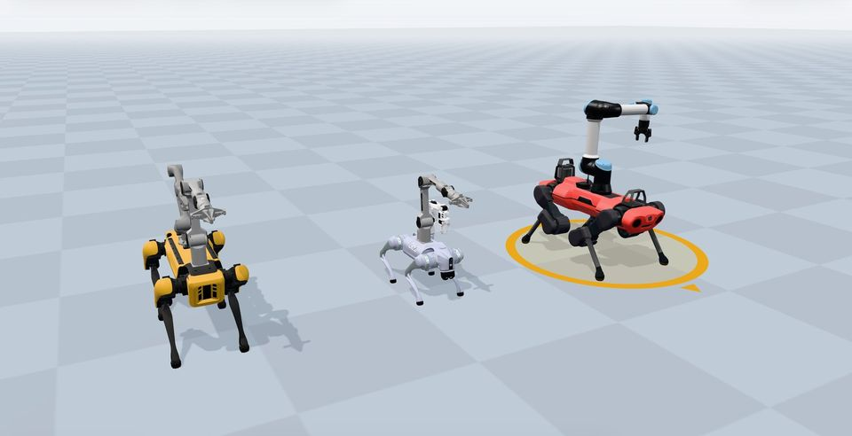
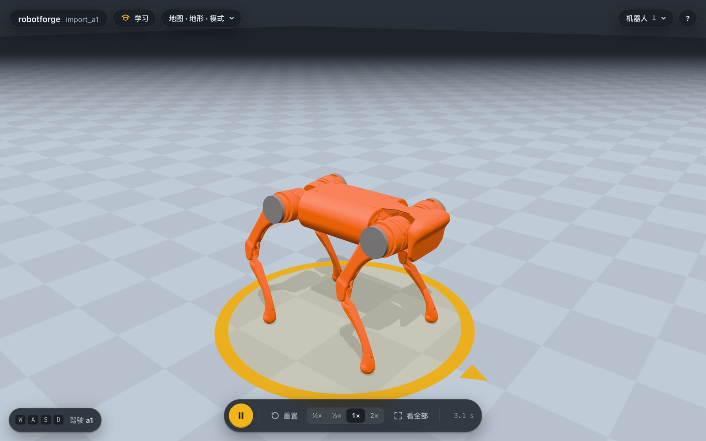
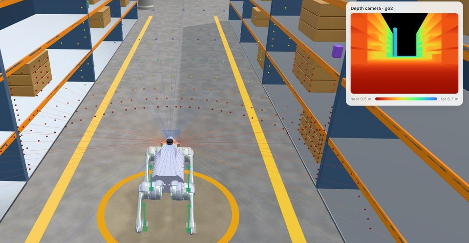
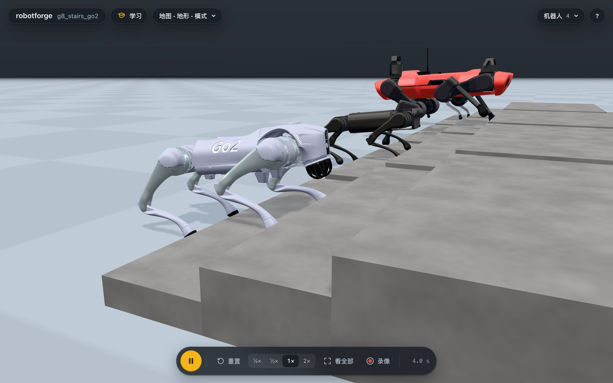
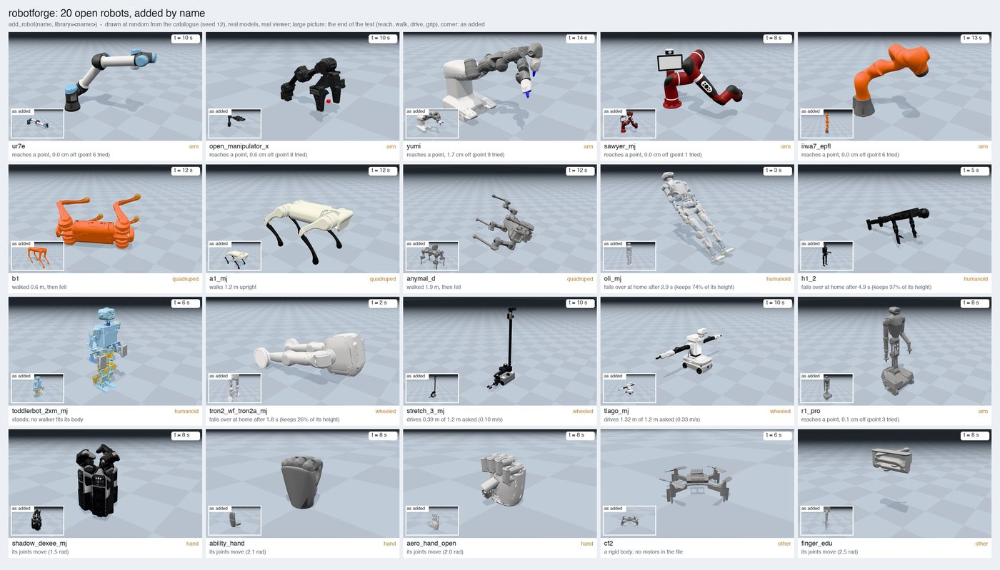
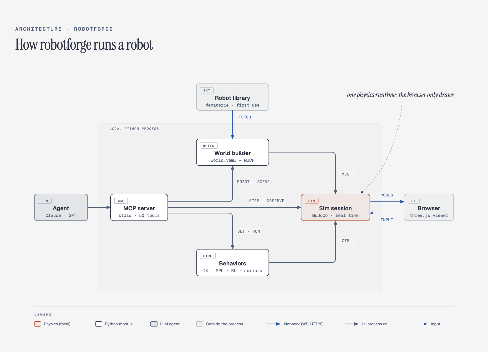

# robotforge

**Real robot models. Your own designs. One lightweight simulator.**

[](https://github.com/yusenthebot/robotforge/actions/workflows/ci.yml)
[English](README.md) | [简体中文](README.zh-CN.md)



robotforge brings robot models, scenes, sensors and controls into a local simulation workspace.
Load a Go2, Panda, UR5e, PiPER or G1 by name, open your own URDF or MJCF, or combine a base, arm and gripper into a new design.
Use Claude or GPT through MCP, write Python scripts, or explore directly in the browser viewer.

[MuJoCo](https://mujoco.org/) runs the physics in Python; a thin three.js viewer displays the scene over WebSocket.
The project focuses on shared material quality, fast loading and creative play, with reusable assets and robot models downloaded on demand.
It runs on macOS, Windows and Linux.

## Start with a real robot

- **Load models by name.** The curated library includes Unitree Go2, Boston Dynamics Spot, ANYmal C, Franka Panda, UR5e, AgileX PiPER, Unitree G1 and Booster T1, alongside a larger [open robot catalogue](docs/CATALOGUE.md).
- **Bring your own model.** Import URDF, xacro, MJCF and mesh files with an import health report; export worlds as MJCF, or individual robots as MJCF or URDF, with their meshes. MJCF preserves actuators; URDF does not ([import and export](docs/EXTENDING.md)).
- **Combine robots.** Mount arms, grippers and sensors on existing models, with mass, balance and reach checks. Build custom geometry from parts when you need a different structure ([builder](docs/BUILDER.md)).
- **Explore scenes and terrain.** Drive through a warehouse or park, place props with plastic, wood or steel surfaces, duplicate their settings, adjust robot starts and headings, and save layouts to restore later ([creative play](docs/CREATIVE_PLAY.md), [scenes](docs/SCENES.md)).
- **See what the robot senses.** View cameras, depth, segmentation, lidar, IMU and contact readings; try mapping, localization and navigation ([sensors](docs/SENSORS.md), [perception](docs/PERCEPTION.md)).
- **Control, compare and extend.** Use keyboard or gamepad controls, scripts and plugins; compare controllers or train policies with shared task and experiment records. PPO and SAC use the optional `rl` dependencies ([algorithms](docs/ALGORITHMS.md), [training](docs/TRAINING.md), [plugins](docs/EXTENDING.md)).

Model availability and controller support are separate: the catalogue reports whether a model loads, stands and moves in its recorded checks.
See its per-model results and the [legged](docs/LEGGED.md), [humanoid](docs/HUMANOID.md) and [mobile manipulation](docs/MOBILE.md) guides for current limits.

For an existing Zeno Malo description package, the [local Malo workspace guide](docs/MALO.md) covers import, independent steering, joint controls and reusable saved designs.
Malo meshes stay local; the guide records controller and sensor limits.

## In the viewer

These are actual viewer captures of real robot models in simulation.

<table>
  <tr>
    <td width="33%"><br><sub><b>Model import.</b> Unitree A1 loaded from the manufacturer's URDF.</sub></td>
    <td width="33%"><br><sub><b>Sensors.</b> Go2 with lidar and a live depth-camera view.</sub></td>
    <td width="33%"><br><sub><b>Terrain.</b> Explore the Go2 model on a stair course.</sub></td>
  </tr>
</table>



*Catalogue sample: arms, quadrupeds, humanoids, mobile bases and hands.
The grid retains failed standing or motion checks as well as successful ones; loading a model does not certify a controller for it.*

## Quick start

robotforge uses [uv](https://docs.astral.sh/uv/) to manage Python and dependencies.
Install uv once:

```bash
# macOS / Linux
curl -LsSf https://astral.sh/uv/install.sh | sh
# Windows (PowerShell)
powershell -ExecutionPolicy ByPass -c "irm https://astral.sh/uv/install.ps1 | iex"
```

### Open your model, no agent needed

```bash
uvx --from git+https://github.com/yusenthebot/robotforge robotforge open path/to/robot.urdf
```

URDF, xacro and MJCF are supported.
To explore the built-in sample scene, replace `open path/to/robot.urdf` with `demo`.
The first launch downloads Python dependencies; library models are fetched separately on first use and cached locally.

### Claude Code

```
/plugin marketplace add yusenthebot/robotforge
/plugin install robotforge@robotforge
```

Then run `/reload-plugins` or start a new session.
The plugin brings all the tools, a skill that teaches the agent how to load and build robots, plus optional lesson prompts.
If the tools are missing on the very first start (the dependencies are still downloading), wait a moment and reconnect robotforge in `/mcp`.

### Codex (GPT)

```bash
codex plugin marketplace add yusenthebot/robotforge
codex plugin add robotforge@robotforge
```

Then open a new Codex session (or browse with `/plugins`).
The plugin marks robotforge's tools as pre-approved, so non-interactive runs such as `codex exec` work too.

### Claude Desktop

Double-click `robotforge-0.0.1.mcpb` and press Install; Claude Desktop prepares the environment with uv.
There is no published release yet, so build the bundle locally:

```bash
uv run python scripts/build_desktop.py   # writes dist/robotforge-0.0.1.mcpb and dist/robotforge-skill.zip
```

To add the optional skill to Claude Desktop, upload `dist/robotforge-skill.zip` under Settings > Capabilities > Skills.

## Ask Claude or GPT

- "Load a Unitree Go2 in a warehouse. I want to drive it with the keyboard."
- "Import this URDF: `/path/to/robot.urdf`, and explain the import health report."
- "Mount a PiPER arm on a Go2 and show the payload and reach checks."
- "Add a lidar and a depth camera to the Go2 and show their readings."
- "Load a Panda and show its joint and end-effector controls."
- "Create an obstacle route, save the layout, then let me drive it again."
- "Which tasks and controllers are supported for this robot?"

The viewer supports model inspection, joint sliders, dragging and keyboard or gamepad controls where the robot has a matching controller.
Worlds are saved in `~/robotforge/worlds/`; scripts live in each world's `behaviors/` folder.
Templates and interactive lessons remain available for quick experiments; see [building from parts](docs/BUILDER.md) and [lessons](docs/lessons/README.md).

## Materials and model fidelity

The viewer reuses shared surfaces and textures across scenes.
Imported image textures and explicitly authored non-ground MJCF roughness and metallic values are retained, while registered surfaces and built-in material presets keep their existing priority.
See the [asset engine](docs/ASSETS.md), [material verification](docs/bench/2026-10-24-native-pbr.md) and [performance budgets](docs/bench/budget.json) for implementation details and measured costs.
The screenshots show existing model and sensor workflows; the verification report contains the material comparisons.

## How it works



The agent calls local tools over MCP; Python owns the simulation, robot capabilities, tasks, algorithms and experiment records.
The browser receives body poses over WebSocket and sends interaction back.
The diagram has an editable [HTML source](docs/diagrams/architecture.html).

## Documentation

- [Goals and acceptance](docs/GOAL.md) · [Roadmap](docs/ROADMAP.md) · [Project plan](docs/OVERVIEW.md)
- [Robot catalogue](docs/CATALOGUE.md) · [Builder](docs/BUILDER.md) · [Asset engine](docs/ASSETS.md)
- [Scenes and terrain](docs/SCENES.md) · [Creative play](docs/CREATIVE_PLAY.md)
- [Sensors](docs/SENSORS.md) · [Perception and mapping](docs/PERCEPTION.md) · [Navigation](docs/NAVIGATION.md)
- [Algorithms](docs/ALGORITHMS.md) · [Training](docs/TRAINING.md) · [Policy playback and UniLab](docs/UNILAB.md)
- [Legged robots](docs/LEGGED.md) · [Humanoids](docs/HUMANOID.md) · [Manipulation](docs/MANIPULATION.md) · [Mobile manipulation](docs/MOBILE.md)
- [ZenoBench house tasks on MuJoCo, without Isaac Sim](docs/ZENOBENCH.md)
- [Scripts, plugins and export](docs/EXTENDING.md) · [Plugin packaging](docs/PLUGINS.md)
- [Current status](STATUS.md) · [Progress](progress.md) · [0.0.1 snapshot notes](docs/RELEASE_0.0.1.md)

<details>
<summary>Earlier video walkthrough</summary>

[Watch the original one-minute tour (MP4, 1080p)](docs/media/promo.mp4).
It includes real robot models, early generated prototypes and teaching demos, recorded with `scripts/demos.py` and edited with `scripts/promo.py`.
The README screenshots were produced with `scripts/screenshots.py`.

</details>
