# robotforge

**Any robot, from a sentence, in a lightweight simulator.**

[](https://github.com/yusenthebot/robotforge/actions/workflows/ci.yml)
[English](README.md) | [简体中文](README.zh-CN.md)

[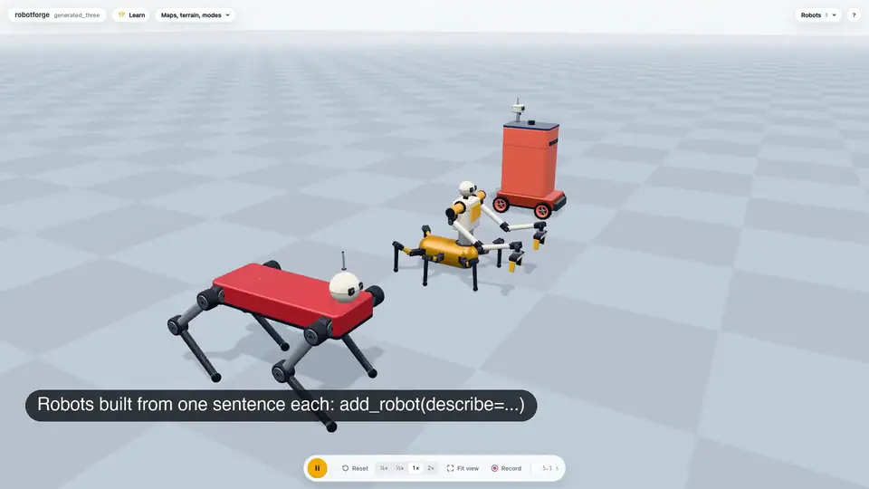](docs/media/promo.mp4)

*Click the preview for the 1 minute tour (MP4, 1080p).
Every shot is real footage of the viewer, recorded with `scripts/demos.py` and cut with `scripts/promo.py`.*

robotforge is a robot playground you drive with words.
Tell Claude or GPT what you want, and it builds the robot, puts it in a world, makes it move, and shows it live in a 3D viewer in your browser.
The physics is [MuJoCo](https://mujoco.org/), the viewer is a thin three.js page, and the agent talks to it through an MCP server, so there is nothing to configure and nothing heavy to install.
It runs on macOS, Windows and Linux.

## What you can do

- **Build any robot from words or parts.** `add_robot(describe="a tall wheeled courier with a lidar")` assembles one from a sentence. Or start from a template (arm, quadruped, rover, humanoid, cart-pole, boat, underwater robot, drone), pick one of ten ready-made odd designs, or put it together part by part from servos, links and wheels ([builder guide](docs/BUILDER.md)).
- **Import your own.** URDF, xacro, MJCF and mesh files go through a health check that repairs the usual problems (mesh formats, inertia, the starting pose).
- **Use real robots, and splice them.** Nineteen robots and parts from MuJoCo Menagerie load by name: Unitree Go2, Boston Dynamics Spot, ANYmal C, Franka Panda, UR5e, AgileX PiPER, Unitree G1, Booster T1, ALOHA 2 and more. Mount any of them on another: a Go2 with a PiPER on its back, an ANYmal C with a UR5e and a Robotiq gripper, a Spot with a Z1.
- **Sense.** Cameras (colour, depth, segmentation), 2D and 3D lidar, IMU, joint encoders, force and touch go on any robot, and the viewer draws the rays and the depth picture ([sensors](docs/SENSORS.md)).
- **Move things around.** A mobile arm plans its drive and its reach together, fetches the apple from the kitchen island, and puts it on the dining table. Drawers, cabinets, buttons, switches, levers and valves can be operated, and a factory conveyor feeds boxes to a sorting arm.
- **Generate worlds and tasks.** `load_scene(description=...)` lays out a home, a warehouse or a hillside from one sentence, and `add_task` turns the same sentence into a task with a success check ([scenes](docs/SCENES.md)).
- **Learn to walk.** Any legged robot, built from parts or imported, learns a rhythm by trial and error in the viewer, keeps it, and then walks and turns with the keyboard or from chat.
- **Go on water, and in the air.** A boat crosses a lake between buoys to a dock, an underwater robot dives, a quadcopter flies a square round a tree.
- **Teach and learn.** The viewer's Learn button opens 13 interactive lessons, 4 benches, 2 face-offs against real robots and 3 challenges, each step "guess first, then try".

## Quick start

robotforge uses [uv](https://docs.astral.sh/uv/) to manage Python and its dependencies.
Install uv once:

```bash
# macOS / Linux
curl -LsSf https://astral.sh/uv/install.sh | sh
# Windows (PowerShell)
powershell -ExecutionPolicy ByPass -c "irm https://astral.sh/uv/install.ps1 | iex"
```

The first start downloads about 50 MB of Python packages (and a Python 3.12 if you have none); after that it starts in about a second.

### Try the viewer, no agent needed

```bash
uvx --from git+https://github.com/yusenthebot/robotforge robotforge demo
```

To open a robot of your own, replace `demo` with `open path/to/robot.urdf` (URDF, xacro or MJCF).

### Claude Code

```
/plugin marketplace add yusenthebot/robotforge
/plugin install robotforge@robotforge
```

Then run `/reload-plugins` or start a new session.
The plugin brings all the tools, a skill that teaches the agent how to build robots and how to teach beginners, and the prompts of the first nine lessons.
If the tools are missing on the very first start (the dependencies are still downloading), wait a moment and reconnect robotforge in `/mcp`.

### Codex (GPT)

```bash
codex plugin marketplace add yusenthebot/robotforge
codex plugin add robotforge@robotforge
```

Then open a new Codex session (or browse with `/plugins`).
The plugin marks robotforge's tools as pre-approved, so non-interactive runs such as `codex exec` work too.

### Claude Desktop

Double-click `robotforge-0.1.0.mcpb` and press Install; Claude Desktop prepares the environment with uv.
There is no published release yet, so build the bundle locally:

```bash
uv run python scripts/build_desktop.py   # writes dist/robotforge-0.1.0.mcpb and dist/robotforge-skill.zip
```

To teach Claude Desktop the teaching skill too, upload `dist/robotforge-skill.zip` under Settings > Capabilities > Skills.

## Ask Claude or GPT

Once it is installed, say things like:

- "Give me a four-legged robot dog on grass and have it walk forward for 10 seconds."
- "Build a robot arm that puts the red cube in the blue box."
- "Make me a six-legged robot with two arms, and a tall wheeled courier with a lidar." (built from the sentences)
- "Put a PiPER arm on a Unitree Go2, and have it carry the cube to the bin."
- "Generate a small flat with a kitchen and a bedroom, and bring the red cup from the kitchen to the bedroom desk."
- "Add a lidar and a depth camera to a Go2 and walk it down the warehouse aisle."
- "Open the drawer in the kitchen."
- "Import this URDF: `/path/to/robot.urdf` and tell me what the health check found."
- "My imported robot has no gait. How do I get it to learn to walk?"
- "Teach me lesson 1."

The agent opens the 3D viewer early.
You can drag the robot, pull the sliders that drive each motor, and use W A S D to drive anything that walks or rolls.
Worlds are saved in `~/robotforge/worlds/`, and the scripts the agent writes are in each world's `behaviors/` folder: edit and rerun them as you like.
Changing a world (adding a box, swapping the floor) keeps the robots and objects where they are.

## Gallery

All of these are real screenshots of the viewer (`uv run python scripts/screenshots.py`).

<table>
  <tr>
    <td width="33%">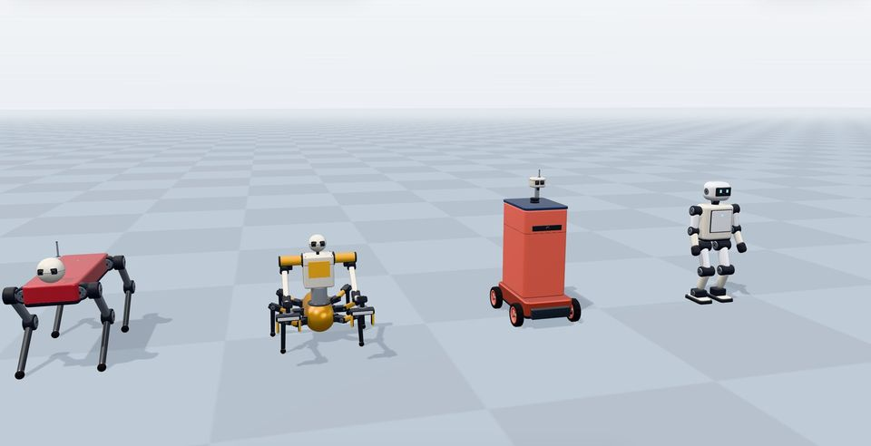<br><sub><b>Robots from a sentence.</b> A humanoid, a courier, a six-legged robot with two arms and a dog, each from one line of text.</sub></td>
    <td width="33%">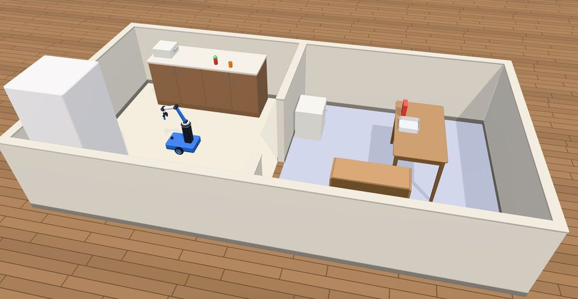<br><sub><b>A world and a task from a sentence.</b> A flat with a kitchen and a bedroom; the picker brings the red cup.</sub></td>
    <td width="33%"><br><sub><b>Real robots spliced.</b> ANYmal C with a UR5e and a Robotiq gripper, a Go2 with two arms, a Spot with a Z1 and a PiPER.</sub></td>
  </tr>
  <tr>
    <td width="33%">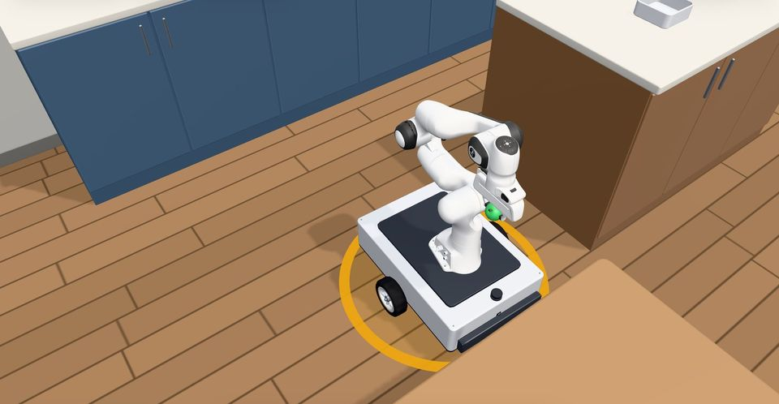<br><sub><b>Mobile pick and place.</b> The Panda on wheels drives to the apple, grasps it and carries it to the dining table.</sub></td>
    <td width="33%"><br><sub><b>Sensors.</b> A Go2 with a 3D lidar and a depth camera; the points and the depth picture are drawn live.</sub></td>
    <td width="33%">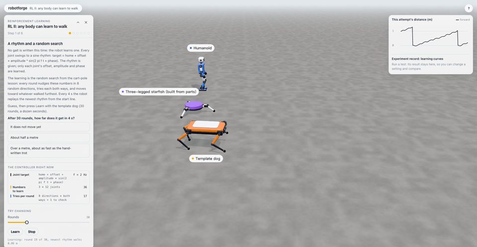<br><sub><b>Learning to walk.</b> A dog, a three-legged starfish and a humanoid each learn a gait; the curve is on the right.</sub></td>
  </tr>
  <tr>
    <td width="33%">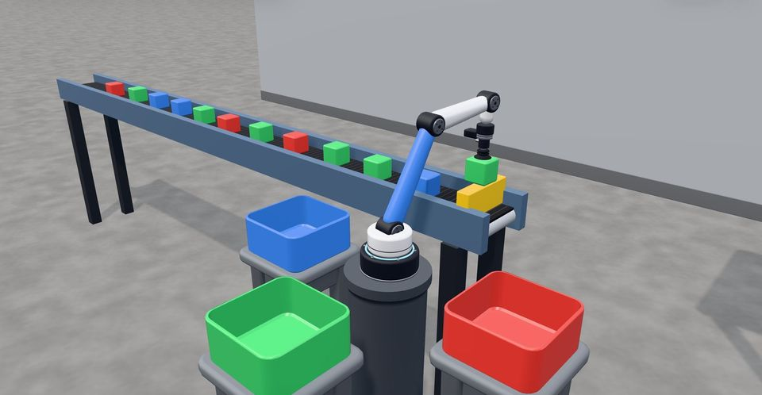<br><sub><b>Mechanisms.</b> The factory belt brings boxes to the stop, the camera names their colour, the arm sorts them.</sub></td>
    <td width="33%">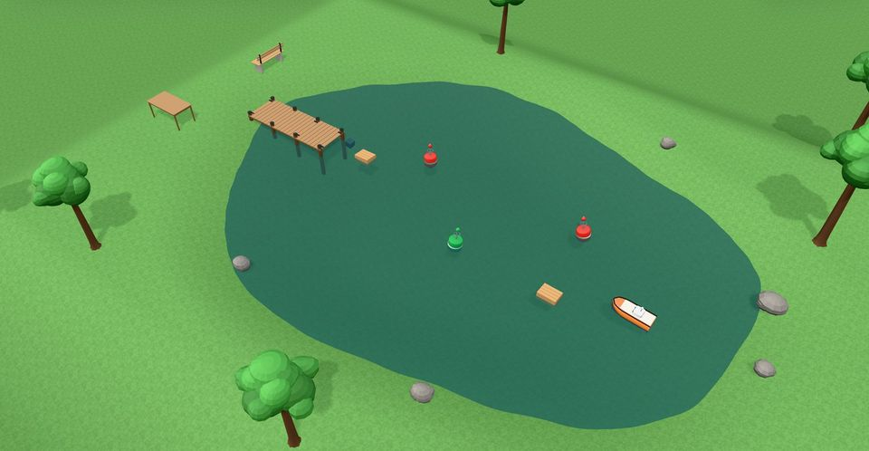<br><sub><b>Water.</b> A boat plans its way between the buoys to the dock; an underwater robot dives beside it.</sub></td>
    <td width="33%">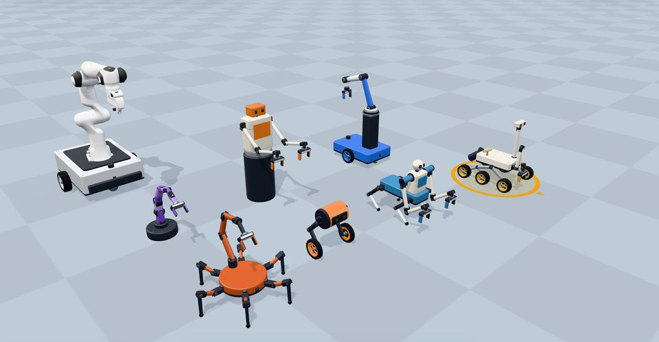<br><sub><b>Built from parts.</b> Ten odd robots (wheel-legged biped, Mars rover, centaur, scorpion, tentacle arm) that really work.</sub></td>
  </tr>
</table>

## Import your own robot

Give the agent the path of a URDF, xacro, MJCF or mesh file.
robotforge checks it, repairs the common problems (mesh formats, inertia, the starting stance), and puts it in your world.


An imported robot that can walk already has the built-in gait.
To make it walk its own way, open Learn in the viewer, choose "RL II", pick your robot under "Which robot", and press Learn.
A dozen seconds later it has a gait; press "Keep this walk for my robot" and it goes on to learn turning left and right on the spot.
Back in your world, tell it to walk in chat, or select it and press W A S D.

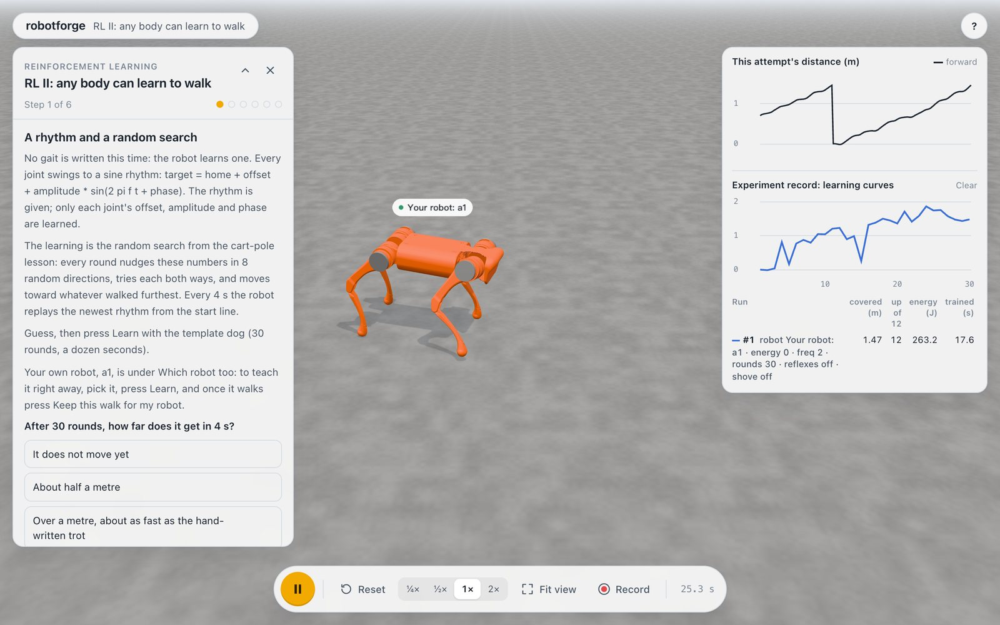

## Learn in the viewer

Press **Learn** at the top left of the viewer.
Each step asks you to guess first and then try, and your results stack up in a lab notebook so you can compare them.

- **Lessons:** PID (a forearm, then the PiPER's shoulder), inverse kinematics (a planar two-link arm, then a six-axis arm and the PiPER), motion planning (RRT-Connect round a barrier), perception (sensors, two vacuum robots comparing lidar avoidance, then finding a red cube by colour with a camera and picking it up), quadruped gaits (the template dog, then the Go2), humanoid balance (the capture point, then the G1), reinforcement learning (a pendulum, then any robot learning to walk, including ones you built or imported), and imitation learning (you demonstrate the grasp, a nearest-neighbour rule and a small neural network copy you, DAgger corrects them).
- **Benches:** PID triplets, LQR twins, MPC twins and gait twins: the same test, a different setting each, run side by side.
- **Face-offs:** our arm against the PiPER and the Panda, our humanoid against the G1.
- **Challenges:** maze escape, the unpushable robot, the obstacle course.

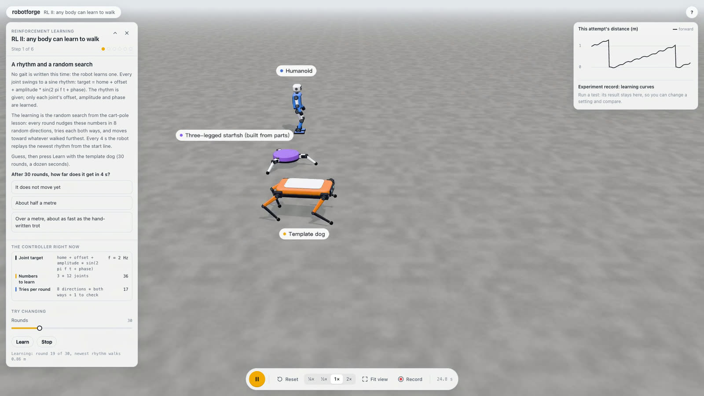

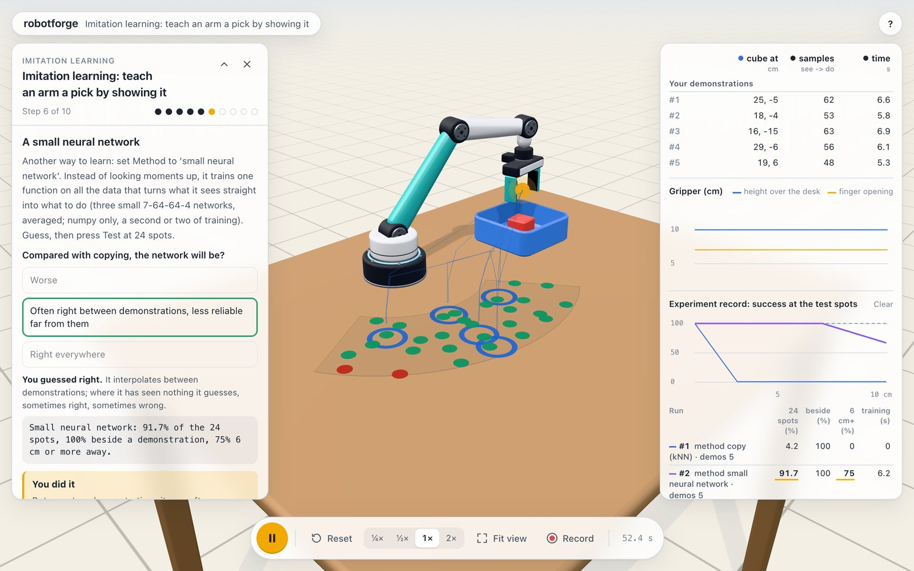

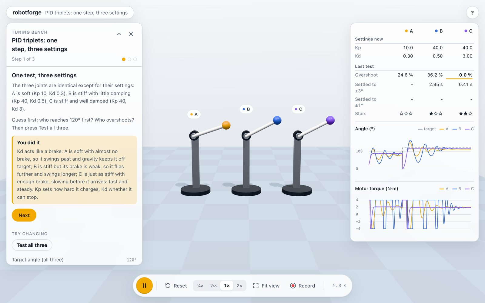

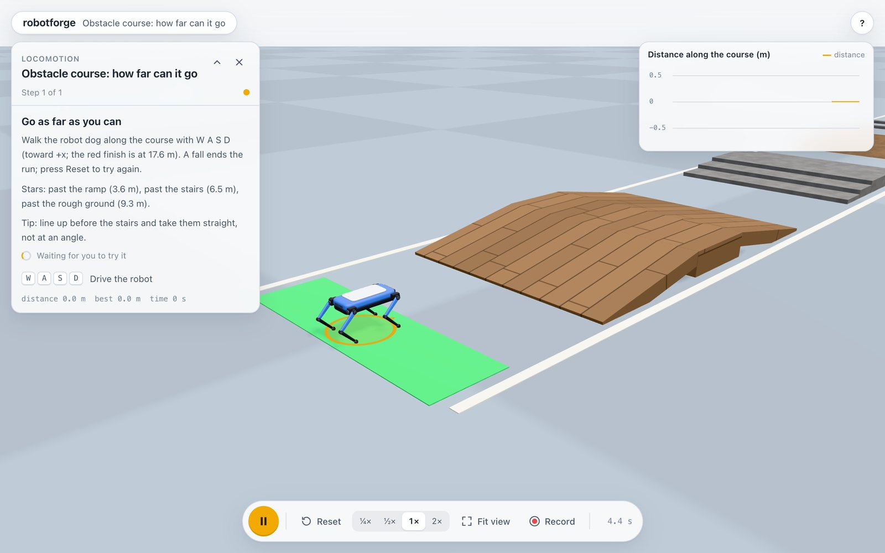

There are also nine written lessons for the chat, each 10 to 20 minutes, in [docs/lessons](docs/lessons/README.md).
A headless playthrough plays every lesson to the end by the book (`uv run python scripts/playtest.py`); all 22 finish (the camera lesson needs offscreen rendering).

## How it works


The agent calls robotforge's tools over MCP, and all the physics runs in one MuJoCo session inside a local Python process.
The browser only draws: it receives the pose of every body over a WebSocket and sends keyboard and drag input back.
The diagram's source is a single HTML file, [docs/diagrams/architecture.html](docs/diagrams/architecture.html); open it in a browser.

## Documentation

- Plan: [docs/OVERVIEW.md](docs/OVERVIEW.md) (Chinese)
- Goals and acceptance: [docs/GOAL.md](docs/GOAL.md)
- Building robots from parts: [docs/BUILDER.md](docs/BUILDER.md)
- Scenes, terrain and generated worlds: [docs/SCENES.md](docs/SCENES.md)
- Sensors: [docs/SENSORS.md](docs/SENSORS.md)
- Navigation: [docs/NAVIGATION.md](docs/NAVIGATION.md)
- Algorithm comparisons: [docs/ALGORITHMS.md](docs/ALGORITHMS.md)
- Learned policies and UniLab training: [docs/UNILAB.md](docs/UNILAB.md)
- Packaging and verifying the plugins (maintainers): [docs/PLUGINS.md](docs/PLUGINS.md)
- Progress: [STATUS.md](STATUS.md), [progress.md](progress.md)
- The pictures above come from `uv run python scripts/screenshots.py`, which drives the real viewer in headless Chrome; the video comes from `scripts/demos.py` and `scripts/promo.py`.
