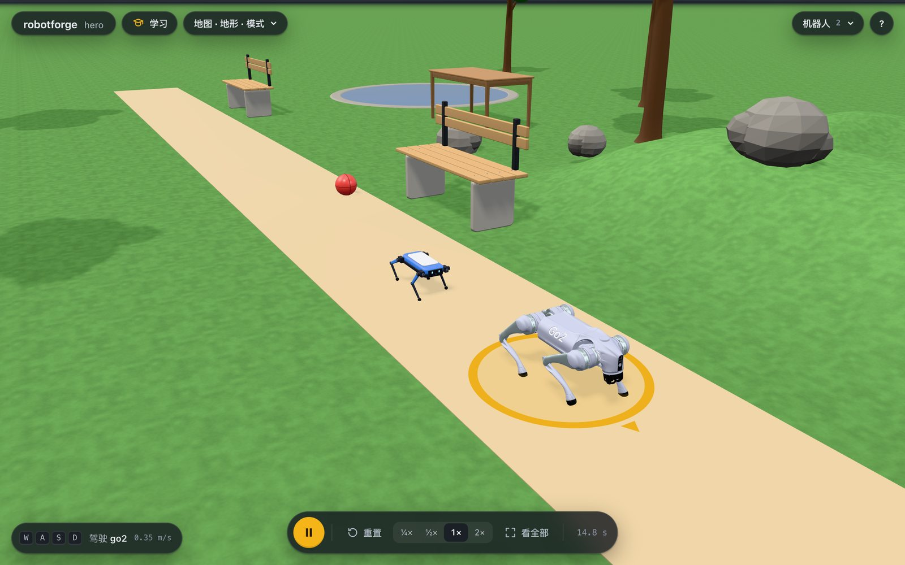
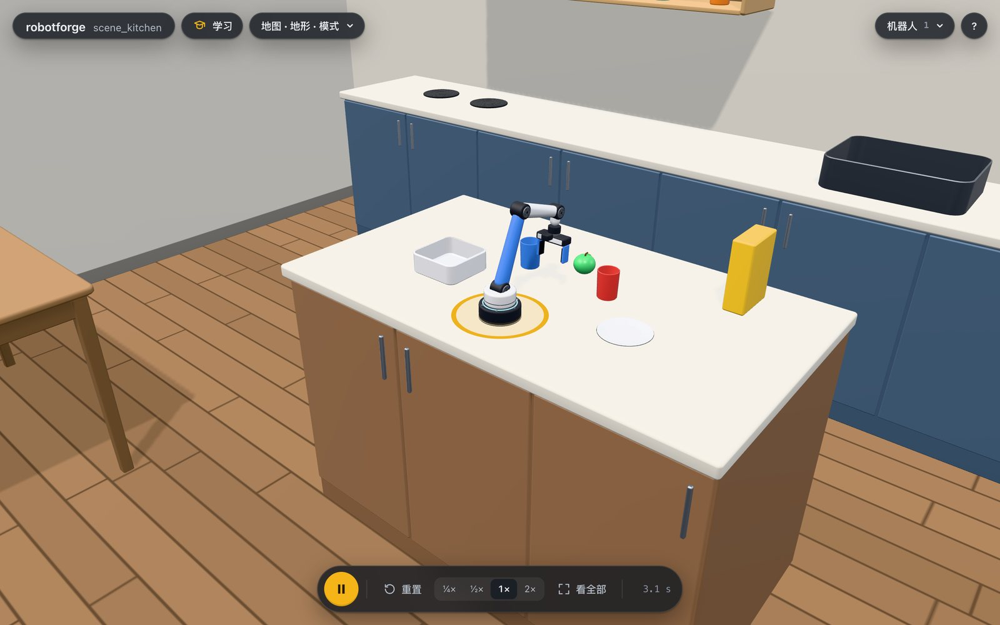

# robotforge (暂名)

[](https://github.com/yusenthebot/robotforge/actions/workflows/ci.yml)

新手入门具身智能的机器人游乐场。
在 Claude 或 GPT 里用一句话描述你想要的机器人，agent 帮你搭出来、让它动起来、在 3D 查看器里实时演示，并顺手讲清楚背后的道理。



- 搭：机械臂、机器狗、小车、人形机器人、倒立摆，或者宇树 Go2、宇树 G1、Franka Panda、AgileX PiPER 这样的真实机器人。
- 挑：设计库里有十个现成的奇特机器人，轮腿双足、火星车、半人马、背着 PiPER 的 Go2、装着 Panda 的移动底盘、六足蝎子、触手等，一句话加进来再一块一块地改（见 [零件拼装](docs/BUILDER.md)）。
- 开：导入你自己的 URDF、xacro、MJCF 或网格文件，自动体检修复。
- 动：走路、开车、抓取放置、摆姿势，或者写一段自己的 Python 脚本。
- 学：查看器里有 11 节互动课、4 个调参台、2 场真机对比和 3 个挑战，每一步先猜再试；同一个任务还能换 PD、LQR、MPC、强化学习比一比。

物理引擎是 MuJoCo，轻量，支持 macOS 和 Windows。

## 安装

robotforge 用 [uv](https://docs.astral.sh/uv/) 管理 Python 和依赖，先装 uv（只需一次）：

```bash
# macOS / Linux
curl -LsSf https://astral.sh/uv/install.sh | sh
# Windows (PowerShell)
powershell -ExecutionPolicy ByPass -c "irm https://astral.sh/uv/install.ps1 | iex"
```

第一次启动会下载约 50 MB 的 Python 依赖（没有 Python 3.12 时还会顺便装一个），之后每次启动约 1 秒。
国内网络慢的话可以先设置镜像：`export UV_DEFAULT_INDEX=https://pypi.tuna.tsinghua.edu.cn/simple`。

### Claude Code

在 Claude Code 里输入：

```
/plugin marketplace add yusenthebot/robotforge
/plugin install robotforge@robotforge
```

装好后运行 `/reload-plugins` 或重开一个会话。
插件带来 robotforge 的全部工具、一个教 agent 怎么搭机器人和怎么教新手的技能，以及九节课的提示词。
第一次启动时如果工具还没出现（依赖还在下载），稍等片刻后在 `/mcp` 里重新连接 robotforge。

### Codex

在终端里运行：

```bash
codex plugin marketplace add yusenthebot/robotforge
codex plugin add robotforge@robotforge
```

然后开一个新的 Codex 会话（也可以在 Codex 里用 `/plugins` 浏览和安装）。
插件已经把 robotforge 的工具设为免确认，所以 `codex exec` 这样的非交互运行也能直接用。

### Claude Desktop

双击 `robotforge-0.1.0.mcpb`，在弹出的窗口里点“安装”，Claude Desktop 会自己用 uv 准备好环境。
目前还没有发布版本，安装包需要在本地构建：

```bash
uv run python scripts/build_desktop.py   # 生成 dist/robotforge-0.1.0.mcpb 和 dist/robotforge-skill.zip
```

想让 Claude Desktop 也学会教学技能，在“设置 > 功能 > 技能”里上传 `dist/robotforge-skill.zip`。

### 不用 agent，直接打开查看器

```bash
uvx --from git+https://github.com/yusenthebot/robotforge robotforge demo
```

发布到 PyPI 之后会变成 `uvx robotforge demo`。
打开自己的机器人：把 `demo` 换成 `open path/to/robot.urdf`。

## 第一句话说什么

装好之后，直接对 agent 说，比如：

- 给我一只四足机器狗，放在草地上，让它往前走 10 秒。
- 做一条机械臂，把红色方块放进蓝色盒子里。
- 加一台宇树 Go2，我想用键盘遥控它。
- 来一台火星车，开过碎石地，再用它的机械臂把一块石头放进盒子。
- 帮我导入这个 URDF：`/path/to/robot.urdf`，告诉我体检报告说了什么。
- 我导入的机器人没有现成的走法，怎么让它自己学会走？
- 教我第 1 课。

agent 会尽早打开 3D 查看器：你可以拖动机器人、拉滑条控制每个电机、用 W A S D 遥控会走的机器人。
所有世界都保存在 `~/robotforge/worlds/` 里，agent 写的脚本在每个世界的 `behaviors/` 文件夹里，可以自己改、反复运行。
改动世界（加个箱子、换地板）时，机器人和物体留在原地，不会跳回起点。



现成的场景有书桌实验室、厨房、仓库、公园、迷宫和障碍赛道，地形有坡、台阶、碎石、起伏的草地和梅花桩。

## 导入你自己的机器人

把 URDF、xacro、MJCF 或网格文件的路径告诉 agent，robotforge 会体检并修好常见问题（比如网格格式、惯量、初始站姿），再放进你的世界。


导入的机器人如果会走，内置步态就能让它走起来。
想让它走出自己的样子，打开查看器的“学习”，进“强化学习（二）”，在“哪个机器人”里选“你的机器人”，点“开始学”。
十几秒后它就学会一种走法，点“把这个走法存给我的机器人”，它接着学原地左转和右转。
回到你的世界，在聊天里叫它走，或者选中它按 W A S D，它就用学到的走法走。


## 学习路线

九节课，每节 10 到 20 分钟，见 [docs/lessons](docs/lessons/README.md)：

1. [关节和舵机](docs/lessons/01-joints-and-actuators.md)
2. [开一台小车](docs/lessons/02-drive-a-rover.md)
3. [让机器狗走起来：什么是步态](docs/lessons/03-dog-walk-and-gait.md)
4. [逆运动学和抓取放置](docs/lessons/04-ik-pick-and-place.md)
5. [传感器和相机](docs/lessons/05-sensors-and-camera.md)
6. [PD、LQR 和 MPC 比一比](docs/lessons/06-pd-lqr-mpc.md)
7. [写自己的脚本](docs/lessons/07-your-own-script.md)
8. [训练一个策略](docs/lessons/08-train-a-policy.md)
9. [导入你自己的机器人](docs/lessons/09-import-a-urdf.md)

## 在查看器里边玩边学

查看器左上角的“学习”打开互动课程，每一步先猜再试，结果留在实验记录里叠着比：

- 课程：PID（小臂，然后 PiPER 肩关节）、逆运动学（平面两连杆，然后六轴臂和 PiPER）、运动规划（RRT-Connect 绕开挡板）、感知（传感器，然后两台扫地机器人比激光雷达避障）、四足步态（模板狗，然后 Go2）、人形平衡（捕获点，然后 G1）、强化学习（倒立摆，然后任何形状的机器人学走路，包括你自己拼的和导入的）。
- 调参台：PID 三胞胎、LQR 双胞胎、MPC 双胞胎、步态双胞胎，同一个测试，各用一组参数，同时跑。
- 真机对比：我们的机械臂对 PiPER 和 Panda，我们的人形对 G1。
- 挑战：迷宫逃脱、推不倒、障碍赛道。


每节课都有一个无头试玩脚本按课文一步步玩到底（`uv run python scripts/playtest.py`），20 节都能走完。

## 架构


agent 通过 MCP 调用 robotforge 的工具，所有物理都在本地 Python 进程里的同一个 MuJoCo 会话中运行。
浏览器只负责显示：它通过 WebSocket 接收每个刚体的位姿，再把键盘和拖拽操作传回来。
图的源文件是单文件 HTML：[docs/diagrams/architecture.html](docs/diagrams/architecture.html)，下载后用浏览器打开即可。

## 文档

- 方案：[docs/OVERVIEW.md](docs/OVERVIEW.md)
- 目标与验收：[docs/GOAL.md](docs/GOAL.md)
- 算法对比：[docs/ALGORITHMS.md](docs/ALGORITHMS.md)
- 插件打包与验证（维护者）：[docs/PLUGINS.md](docs/PLUGINS.md)
- 学习型策略和 UniLab 训练：[docs/UNILAB.md](docs/UNILAB.md)
- 进度：[STATUS.md](STATUS.md)，[progress.md](progress.md)
- README 里的截图由 `uv run python scripts/screenshots.py` 生成，用的是真实的查看器和无头 Chrome。
