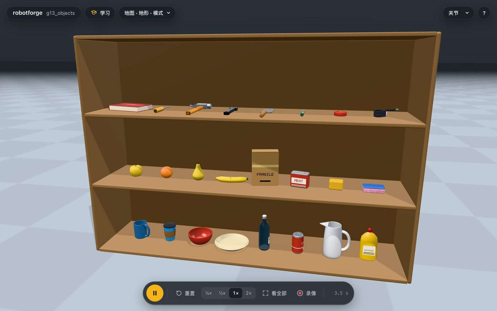
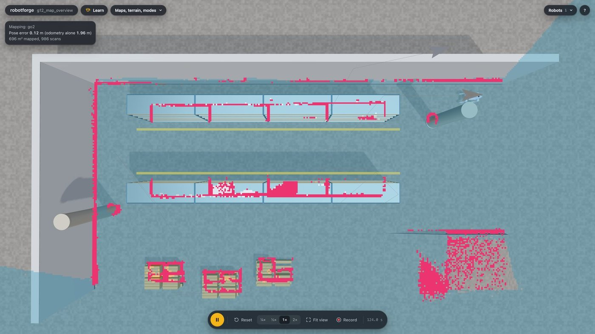
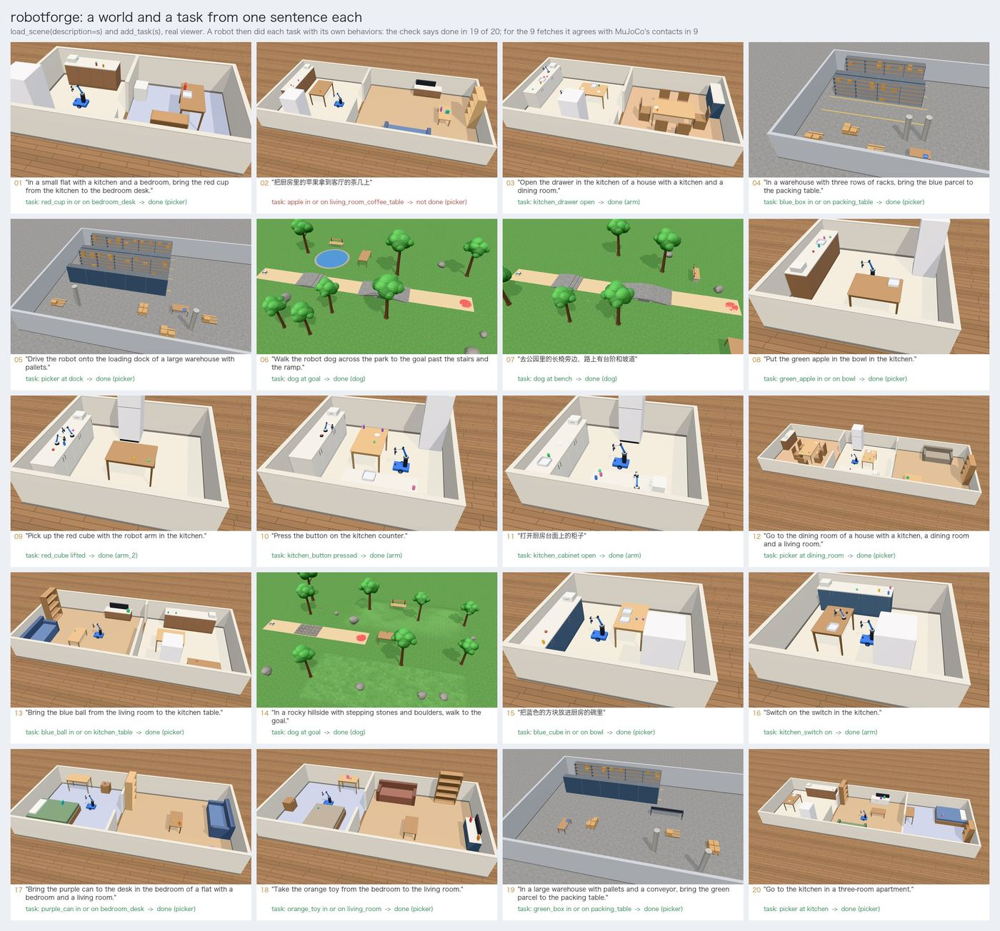
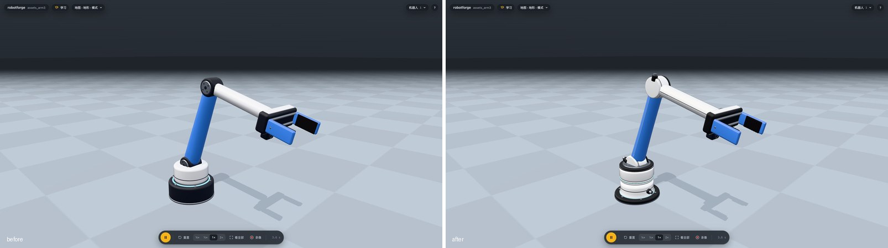
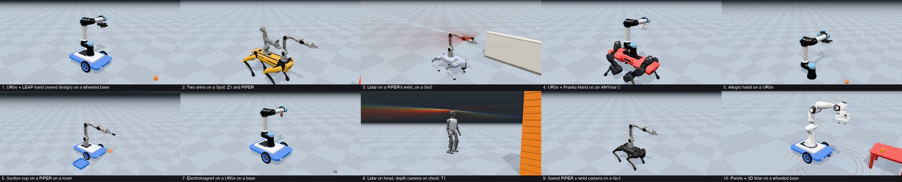

# robotforge (暂名)

**用一句话造出任何机器人，在一个轻量的模拟器里让它动起来。**

[](https://github.com/yusenthebot/robotforge/actions/workflows/ci.yml)
[English](README.md) | [简体中文](README.zh-CN.md)

[](docs/media/promo.mp4)

*点击预览观看一分钟演示（MP4，1080p）。
画面全部是真实查看器的录像，由 `scripts/demos.py` 录制、`scripts/promo.py` 剪辑。*

新手入门具身智能的机器人游乐场。
在 Claude 或 GPT 里用一句话描述你想要的机器人，agent 帮你搭出来、让它动起来、在 3D 查看器里实时演示，并顺手讲清楚背后的道理。

- 搭：`add_robot(describe="一台带激光雷达的高个子轮式快递车")` 一句话生成机器人，`update_robot` 再用一句话改它（“六条腿”“改成红色”）；或者从模板（机械臂、机器狗、小车、人形、倒立摆、小船、水下机器人、无人机）、十个现成的奇特设计、一块一块的零件开始（见 [零件拼装](docs/BUILDER.md)），做不成的设计会被检查拦下并说明原因。每个零件都是生成的，外形风格可选（cobot、lab、hobby、rugged）：带螺丝圈的关节壳、有分模线的外壳、胎纹、拉丝和铸造表面（见 [资产引擎](docs/ASSETS.md)，英文）。
- 导入和导出：导入你自己的 URDF、xacro、MJCF 或网格文件，自动体检修复；`export_model` 把机器人或整个世界导出成带网格的 MJCF 或 URDF。URDF 不带电机，要保留电机请用 MJCF。
- 用约 200 台真机，还能拼：22 台调好的真实机器人（宇树 Go2、波士顿动力 Spot、ANYmal C、Franka Panda、UR5e、AgileX PiPER、宇树 G1、Booster T1、ALOHA 2 等）加 175 台开源机器人目录里的，按名字加载（见 [目录](docs/CATALOGUE.md)，英文）。`mount` 把一台装到另一台上，比如 Go2 背 PiPER、ANYmal C 背 UR5e 加 Robotiq 夹爪、Spot 背 Z1、手腕上装激光雷达，并检查质量、平衡和够取范围，会倒的组合直接拒绝。
- 生成世界、物体和任务：`load_scene(description=...)` 一句话生成一个家、仓库、公园或山坡，`add_task` 把同一句话变成带成功判定的任务，中英文都行。24 种生成的物体（杯子、瓶子、碗、工具、水果、带标签的箱子）自带抓取提示，任务套件涵盖取送、堆叠、插入、倒东西和递物。
- 走地形：腿足机器人读地面，过斜坡、台阶、碎石和踏石；人形机器人能站稳、经得起一推，在平地上能走。
- 搬东西：带轮子的机械臂把行走和够取一起规划，从厨房岛台取苹果放到餐桌上；`plan_grasp` 选抓取方式（杯子抓把手）；`operate` 操作抽屉、柜子、按钮、开关、拉杆、阀门，还能限制用力；工厂传送带把箱子送给分拣臂。
- 随你的方式操控：W A S D 或手柄驱动任何会走会滚的机器人，也能点动机械臂；任务逻辑可以写成行为树或状态机；示范可以录下来，在同类的另一台机器人上回放。
- 感知：相机（彩色、深度、分割、双目、鱼眼、事件）、二维和三维激光雷达、声呐、IMU、关节编码器、轮式里程计、力、触觉皮肤、温度和气体都能装在任何机器人上，查看器里实时画出来。
- 建图和定位：机器人边走边用激光雷达和有漂移的里程计画占据栅格地图，粒子滤波校正位姿，自己探索陌生空间，只靠自己的地图走到指定地点。
- 任意算法训练任意机器人：一次调用就能用 ARS、CEM、PPO、SAC 或你自己写的算法训练，几个算法并排跑，或者做设置搜索，边跑边淘汰差的试验；查看器的训练面板实时画出每个试验的曲线和设置，并播放最好的策略。
- 学走路，也学模仿：任何有腿的机器人（拼出来的或导入的）在查看器里靠试错学出一种节奏，存下来之后用键盘或在聊天里叫它走和转；模仿学习课里你示范抓取，小神经网络照着学。
- 水上和空中：小船在浮标之间开到码头，水下机器人下潜，四旋翼绕着树飞一个方形。
- 自己扩展：把 Python 文件放进 `~/.robotforge/plugins`，就多出一个零件、传感器、控制器或行为，用起来和内置的一样；一段脚本既能控制模板狗也能控制 Go2（见 [docs/EXTENDING.md](docs/EXTENDING.md)，英文）。
- 教学：查看器里有 13 节互动课、4 个调参台、2 场真机对比和 3 个挑战，每一步先猜再试。
- 给 Claude 和 GPT 用：60 个 MCP 工具、一个教 agent 的 skill，还有 Claude Code 和 Codex 插件。

版本 0.0.1：第一个打标记的快照，能做什么、怎么验证的、还有哪些做不到，见 [发布说明](docs/RELEASE_0.0.1.md)（英文，末尾有中文摘要）。

### 0.0.1 新能力

<table>
  <tr>
    <td width="33%"><br><sub><b>物体。</b>杯子、瓶子、碗、工具、水果和带标签的箱子，都是生成的，自带抓取提示。</sub></td>
    <td width="33%"><br><sub><b>训练面板。</b>机械臂学着够红球：两种算法九个试验，边跑边淘汰。</sub></td>
    <td width="33%"><br><sub><b>建图。</b>Go2 给陌生仓库建图，位姿误差 0.12 米，只靠里程计是 1.96 米。</sub></td>
  </tr>
  <tr>
    <td width="33%"><br><sub><b>按名字加载的开源机器人。</b>随机抽 20 台，都是查看器里的真实画面；有的会摔倒，图里也如实标了。</sub></td>
    <td width="33%"><br><sub><b>一句话生成世界。</b>20 句话、20 个世界和任务，判定结果 19 个完成。</sub></td>
    <td width="33%"><br><sub><b>资产引擎。</b>同一个三关节机械臂前后对比：圆角底座、螺丝圈、关节壳和外壳。</sub></td>
  </tr>
</table>



物理引擎是 MuJoCo，轻量，支持 macOS、Windows 和 Linux。
英文版的图集和更完整的提问示例见 [README.md](README.md)。

## 安装

robotforge 用 [uv](https://docs.astral.sh/uv/) 管理 Python 和依赖，先装 uv（只需一次）：

```bash
# macOS / Linux
curl -LsSf https://astral.sh/uv/install.sh | sh
# Windows (PowerShell)
powershell -ExecutionPolicy ByPass -c "irm https://astral.sh/uv/install.ps1 | iex"
```

第一次启动会下载约 50 MB 的 Python 依赖（没有 Python 3.12 时还会顺便装一个），之后每次启动约 1 秒。
国内网络慢的话可以先设置镜像：`export UV_DEFAULT_INDEX=https://pypi.tuna.tsinghua.edu.cn/simple`。

### Claude Code

在 Claude Code 里输入：

```
/plugin marketplace add yusenthebot/robotforge
/plugin install robotforge@robotforge
```

装好后运行 `/reload-plugins` 或重开一个会话。
插件带来 robotforge 的全部工具、一个教 agent 怎么搭机器人和怎么教新手的技能，以及九节课的提示词。
第一次启动时如果工具还没出现（依赖还在下载），稍等片刻后在 `/mcp` 里重新连接 robotforge。

### Codex

在终端里运行：

```bash
codex plugin marketplace add yusenthebot/robotforge
codex plugin add robotforge@robotforge
```

然后开一个新的 Codex 会话（也可以在 Codex 里用 `/plugins` 浏览和安装）。
插件已经把 robotforge 的工具设为免确认，所以 `codex exec` 这样的非交互运行也能直接用。

### Claude Desktop

双击 `robotforge-0.0.1.mcpb`，在弹出的窗口里点“安装”，Claude Desktop 会自己用 uv 准备好环境。
目前还没有发布版本，安装包需要在本地构建：

```bash
uv run python scripts/build_desktop.py   # 生成 dist/robotforge-0.0.1.mcpb 和 dist/robotforge-skill.zip
```

想让 Claude Desktop 也学会教学技能，在“设置 > 功能 > 技能”里上传 `dist/robotforge-skill.zip`。

### 不用 agent，直接打开查看器

```bash
uvx --from git+https://github.com/yusenthebot/robotforge robotforge demo
```

发布到 PyPI 之后会变成 `uvx robotforge demo`。
打开自己的机器人：把 `demo` 换成 `open path/to/robot.urdf`。

## 第一句话说什么

装好之后，直接对 agent 说，比如：

- 给我一只四足机器狗，放在草地上，让它往前走 10 秒。
- 做一条机械臂，把红色方块放进蓝色盒子里。
- 加一台宇树 Go2，我想用键盘遥控它。
- 来一台火星车，开过碎石地，再用它的机械臂把一块石头放进盒子。
- 帮我导入这个 URDF：`/path/to/robot.urdf`，告诉我体检报告说了什么。
- 我导入的机器人没有现成的走法，怎么让它自己学会走？
- 教我第 1 课。

agent 会尽早打开 3D 查看器：你可以拖动机器人、拉滑条控制每个电机、用 W A S D（或手柄）遥控会走的机器人，手柄摇杆还能移动机械臂、开合夹爪。
所有世界都保存在 `~/robotforge/worlds/` 里，agent 写的脚本在每个世界的 `behaviors/` 文件夹里，可以自己改、反复运行。
改动世界（加个箱子、换地板）时，机器人和物体留在原地，不会跳回起点。


现成的场景有书桌实验室、厨房、仓库、公园、迷宫和障碍赛道，地形有坡、台阶、碎石、起伏的草地和梅花桩。

## 导入你自己的机器人

把 URDF、xacro、MJCF 或网格文件的路径告诉 agent，robotforge 会体检并修好常见问题（比如网格格式、惯量、初始站姿），再放进你的世界。


导入的机器人如果会走，内置步态就能让它走起来。
想让它走出自己的样子，打开查看器的“学习”，进“强化学习（二）”，在“哪个机器人”里选“你的机器人”，点“开始学”。
十几秒后它就学会一种走法，点“把这个走法存给我的机器人”，它接着学原地左转和右转。
回到你的世界，在聊天里叫它走，或者选中它按 W A S D，它就用学到的走法走。


## 学习路线

九节课，每节 10 到 20 分钟，见 [docs/lessons](docs/lessons/README.md)：

1. [关节和舵机](docs/lessons/01-joints-and-actuators.md)
2. [开一台小车](docs/lessons/02-drive-a-rover.md)
3. [让机器狗走起来：什么是步态](docs/lessons/03-dog-walk-and-gait.md)
4. [逆运动学和抓取放置](docs/lessons/04-ik-pick-and-place.md)
5. [传感器和相机](docs/lessons/05-sensors-and-camera.md)
6. [PD、LQR 和 MPC 比一比](docs/lessons/06-pd-lqr-mpc.md)
7. [写自己的脚本](docs/lessons/07-your-own-script.md)
8. [训练一个策略](docs/lessons/08-train-a-policy.md)
9. [导入你自己的机器人](docs/lessons/09-import-a-urdf.md)

## 在查看器里边玩边学

查看器左上角的“学习”打开互动课程，每一步先猜再试，结果留在实验记录里叠着比：

- 课程：PID（小臂，然后 PiPER 肩关节）、逆运动学（平面两连杆，然后六轴臂和 PiPER）、运动规划（RRT-Connect 绕开挡板）、感知（传感器，两台扫地机器人比激光雷达避障，再用相机按颜色找到红方块、算出位置抓起来）、四足步态（模板狗，然后 Go2）、人形平衡（捕获点，然后 G1）、强化学习（倒立摆，然后任何形状的机器人学走路，包括你自己拼的和导入的）、模仿学习（你来示范抓方块，k 近邻和小神经网络照着学，DAgger 纠正）。

- 调参台：PID 三胞胎、LQR 双胞胎、MPC 双胞胎、步态双胞胎，同一个测试，各用一组参数，同时跑。
- 真机对比：我们的机械臂对 PiPER 和 Panda，我们的人形对 G1。
- 挑战：迷宫逃脱、推不倒、障碍赛道。


每节课都有一个无头试玩脚本按课文一步步玩到底（`uv run python scripts/playtest.py`），22 节都能走完（看相机的那节要能离屏渲染）。

## 架构


agent 通过 MCP 调用 robotforge 的工具，所有物理都在本地 Python 进程里的同一个 MuJoCo 会话中运行。
浏览器只负责显示：它通过 WebSocket 接收每个刚体的位姿，再把键盘和拖拽操作传回来。
图的源文件是单文件 HTML：[docs/diagrams/architecture.html](docs/diagrams/architecture.html)，下载后用浏览器打开即可。

## 文档

- 方案：[docs/OVERVIEW.md](docs/OVERVIEW.md)
- 目标与验收：[docs/GOAL.md](docs/GOAL.md)
- 算法对比：[docs/ALGORITHMS.md](docs/ALGORITHMS.md)
- 操作和触觉（抓取规划、插孔、用力拧）：[docs/MANIPULATION.md](docs/MANIPULATION.md)
- 插件打包与验证（维护者）：[docs/PLUGINS.md](docs/PLUGINS.md)
- 学习型策略和 UniLab 训练：[docs/UNILAB.md](docs/UNILAB.md)
- 足式机器人怎么看地面走、每台的实测表：[docs/LEGGED.md](docs/LEGGED.md)
- 移动操作：底盘和臂怎么一起规划、每台机器人各件活的成功率和失败原因：[docs/MOBILE.md](docs/MOBILE.md)
- 进度：[STATUS.md](STATUS.md)，[progress.md](progress.md)
- README 里的截图由 `uv run python scripts/screenshots.py` 生成，用的是真实的查看器和无头 Chrome。
