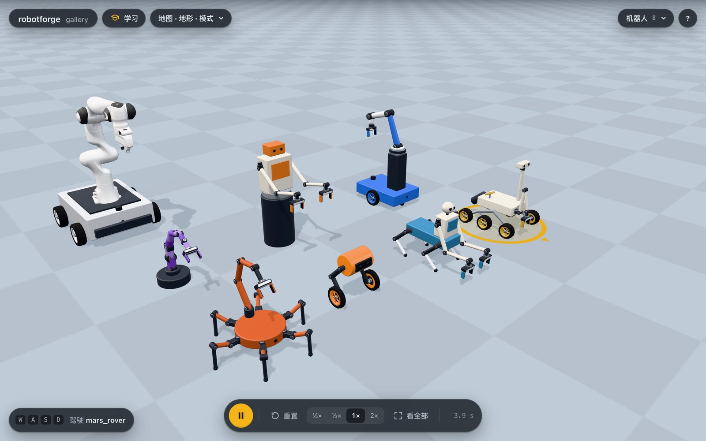
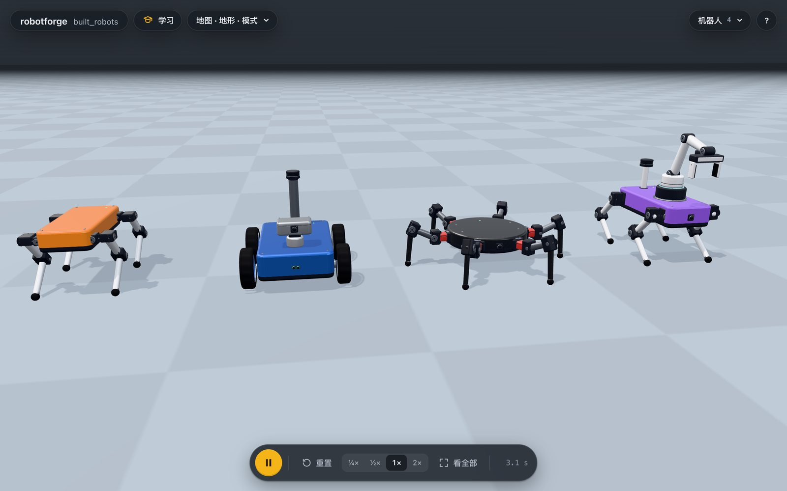
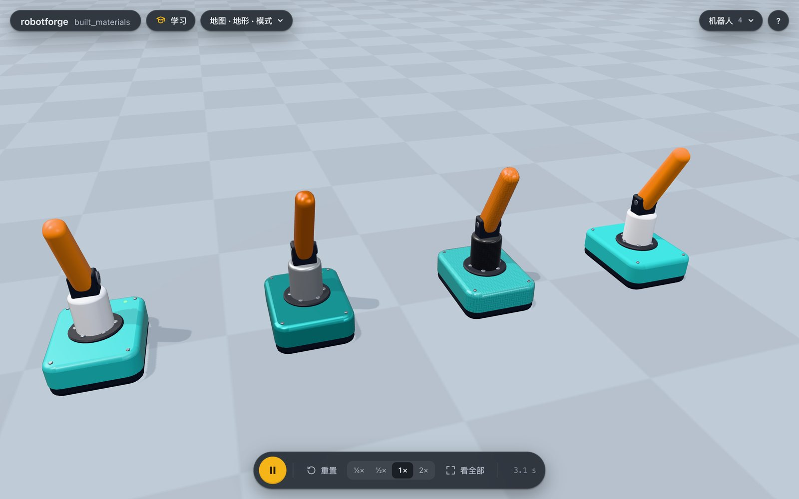

# 零件拼装：用零件造任何机器人

模板只是起点。
用 `build` 可以像搭乐高一样，从一个底座和一串零件造出任何机器人，也可以把模板机器人当成一个零件装上去。
agent 先调用 `builder_guide` 读速查表，再用 `add_robot(name, build={...})` 创建，之后用 `add_part`、`update_part`、`remove_part` 一块一块地改。

## 设计库：一句话加一个现成的奇特机器人

不想从一张白纸开始的话，可以从设计库里挑一个：`add_robot("hopper", design="wheel_biped")`。
设计会作为零件写进 world.yaml，加进来以后它就是一个普通的零件机器人，可以用 `update_part`、`add_part`、`remove_part` 一块一块地改，例如 `update_part(robot="hopper", part="robot", changes={"color": "purple"})`。
`list_templates` 会列出所有设计，每个一句话；`show_world` 能看到它的全部零件。



| 设计 | 是什么 | 怎么用 | 手够得到哪里（夹爪朝下） | 实测（真实仿真） |
|---|---|---|---|---|
| `wheel_biped` | 两条腿末端是驱动轮，像赛格威一样自己平衡，腿撑着半蹲 | `move` 开；`set_controls` 改 `left_thigh`、`left_shin` 等关节就能蹲下或站高 | 没有手 | 0.4 m/s 开 3 秒前进 1.38 m；1.5 rad/s 原地转 3 秒转了 212 度；两秒内把大腿慢慢折到 90 度、身子后仰，照样平衡 |
| `wheel_dog` | 四条腿末端是驱动轮的机器狗，腿上的舵机带 2:1 减速 | `move` 像小车一样开；改腿的角度换姿势 | 没有手 | 0.4 m/s 开 3 秒前进 1.32 m；2 rad/s 原地转 3 秒转了 231 度，最多只歪 2 度，站高了也不翻 |
| `mars_rover` | 六轮摇臂转向架火星车，带摄像头桅杆和采样机械臂 | `move` 开；采样臂叫 `mars_rover/hand` | 车头前方的地面和 0.3 m 以下的石块 | 翻过 6 cm 路沿，6 秒前进 1.97 m；2 rad/s 原地转 3 秒转了 171 度；把石块放进样品盒，也能把右前方的石块挪到左前方 |
| `lift_picker` | 拣货机器人：小车、能升降的立柱和机械臂 | `move` 开；`pick_and_place` 会自己升降立柱 | 0.15 到 0.75 m 高的桌面，离立柱 0.4 m 以内；够不着地面 | 把方块从 0.45 m 的桌子放到 0.62 m 的桌子上，立柱升到 0.25 m，底盘纹丝不动；从左边 0.2 m 的茶几放到右边 0.7 m 的台面上 |
| `mobile_panda` | 真实的 Franka Emika Panda 机械臂装在一台很重的底盘上，中间两个驱动轮、前后各一个万向球，能原地转 | `move` 开；机械臂叫 `mobile_panda/arm` | 前方和两侧的地面和桌面，离机械臂 0.4 到 0.7 m、离车身 10 cm 以外；正后方不算 | 0.4 m/s 开 3 秒前进 1.22 m；2 rad/s 原地转 3 秒转了 188 度；从地上捡起方块放到 0.45 m 的桌子上，也能把左后方地上的方块放进右前方的盒子；在这个范围里随机抓放 40 次，40 次都放准了，放到正后方的 20 次里只有 13 次 |
| `centaur` | 半人马：四条腿走四足步态，宽肩膀的上身有头和两只带夹爪的手 | `move` 走；两只手叫 `centaur/left_hand`、`centaur/right_hand` | 身前的地面和 0.3 m 以下的矮箱子，每只手管自己那一侧 | 0.3 m/s 走 4 秒前进 0.86 m；1 rad/s 原地转 3 秒转了 177 度；左手把方块放进盒子，右手把地上的方块挪到右边 |
| `scorpion` | 蝎子：六足三角步态，尾巴是一条机械臂，末端是夹钳 | `move` 走；尾巴叫 `scorpion/claw` | 身体四周的地面和 0.3 m 以下的箱子，紧贴着腿的地方除外 | 0.25 m/s 走 4 秒前进 1.20 m；1 rad/s 原地转 3 秒转了 165 度；尾巴绕过背把方块挪到一边，也能把左前腿旁边的方块送到右后方；在尾巴够得到的地面上随机抓放 40 次，30 次放准，8 次事先拒绝并说明原因，2 次没放准 |
| `go2_arm` | 真实的宇树 Go2 背着真实的 AgileX PiPER 机械臂（都来自 MuJoCo Menagerie，第一次用时下载） | `move` 走；机械臂叫 `go2_arm/arm` | 身体两侧的地面，到 0.45 m 高的桌面 | 0.4 m/s 走 3 秒前进 1.35 m；1 rad/s 原地转 3 秒转了 177 度；把方块从一张桌子搬到另一张，也能把左边地上的方块从狗头上方搬到右边 |
| `twin_arm` | 双臂工作台：带头的上身装在可转动的腰上，两只手各带夹爪 | 两只手叫 `twin_arm/left_hand`、`twin_arm/right_hand`；腰用 `set_controls` 手动转 | 身前 0.15 到 0.6 m 高的桌面，每只手管自己那一侧；够不着地面 | 两只手各把一个方块放进自己那边的托盘，腰一动不动；左手把桌上的方块放到左边 0.5 m 高的台子上 |
| `tentacle` | 八节触手机械臂，上下、左右交替弯曲，末端是夹爪 | `move_arm`、`pick_and_place` | 离底座 0.2 到 0.35 m 的地面和 0.2 m 以下的台阶 | 把方块绕到身后放进盒子；把身后的方块放到前面 0.1 m 高的台阶上；`move_arm` 末端误差约 8 mm；离底座 0.2 到 0.35 m 随机抓放 40 次全部放准，0.15 到 0.2 m 的 20 次里 15 次放准 |

`go2_arm` 和 `mobile_panda` 用到的真实模型来自 MuJoCo Menagerie：Go2 是 BSD-3-Clause（Unitree Robotics），PiPER 是 MIT（AgileX Robotics），Panda 是 Apache-2.0（Franka Robotics），和机器人库里的一样，第一次使用时下载，不随 robotforge 发布。
`lift_picker` 和 `go2_arm` 的机械臂出场时就折叠收好，靠的是 `robot` 字段的 `home`。
“手够得到哪里”是在机器人四周每隔 10 cm、六个高度上逐点试出来的，`list_templates` 里每个设计的一句话也写了这个范围。
随机抓放的次数是用真实模型跑的：起点和终点都在手够得到的地面上随机挑，方块 4 cm。

## 基本概念

- 单位：米、千克、角度（度）。
- 方向：机器人的前方是 +x，左边是 +y，上方是 +z。
- 每个零件都有自己的坐标系，原点在它的关节上；零件里写的数字都在父零件的坐标系里。
- 零件的名字同时是它的刚体、关节和执行器的名字，在世界里会加上机器人名前缀，例如 `dog/left_thigh_1`。

## 结构

```yaml
robots:
  - name: dog
    build:
      color: orange          # 主色（底座），零件默认白色
      material: pla          # pla、aluminum、carbon、rubber，决定密度和质量
      servo: sts3215         # 铰链默认用的舵机
      motor: tt_motor        # 轮子和连续旋转关节默认用的电机
      linear: l16            # 滑动关节默认用的直线执行器
      base: {shape: box, size: [0.3, 0.14, 0.06], fixed: false, sensors: [imu]}
      parts: [...]
```

底座的 `fixed: true` 表示固定在地面上（机械臂、转台），默认是能自由移动的。
颜色（机器人、底座、零件都有 `color`）可以写颜色名（orange、brown 等）、十六进制 `"#9c6b3f"` 或 `"#963"`，或者 0 到 1 的 `[r, g, b]`；在 world.yaml 里十六进制要加引号，不然 `#` 会被当成注释。
底座和零件的 `color` 写 `main` 就跟着机器人的主色走：改一次机器人的颜色，这些零件一起变。

## 零件字段

| 字段 | 含义 |
|---|---|
| `name` | 小写字母、数字和下划线 |
| `parent` | 挂在哪个零件上，默认 `base` |
| `at` | 挂载点：`[x, y, z]`，或锚点 `top`、`bottom`、`front`、`back`、`left`、`right`、`center`、`start`、`end`，或父零件的 `mounts` 名字 |
| `shift` | 在 `at` 之上再平移 |
| `rotate` | `[横滚, 俯仰, 偏航]`，单位度 |
| `joint` | `hinge`（默认）、`slide`、`fixed`，或 `{type, axis, range, home, continuous, damping, stiffness}` |
| `actuator` | 零件库里的型号，`none` 表示无动力，或 `{model, control, gear}` |
| `shape` | `box`、`sphere`、`capsule`、`cylinder`、`wheel`、`caster`、`none` |
| `size` | box 是 `[长, 宽, 高]`，sphere 和 caster 是 `[直径]`，capsule 和 cylinder 是 `[直径, 长度]`，wheel 是 `[直径, 宽度]` |
| `direction` | 连杆从关节朝哪个方向长出去（腿用 `down`）；不写就以关节为中心 |
| `foot` | `true` 在末端加一个橡胶脚 |
| `sensors` | `imu`、`touch`、`camera`、`rangefinder`、`lidar`，或带参数的写法 |
| `mirror` | `true` 在另一侧加一个镜像副本，名字里的 left 和 right 互换 |
| `repeat` | `{count, around}` 环形排列，`{count, along, spacing}` 一排，`{count, chain: true}` 一节挂一节 |
| `robot` | 把整个模板或机器人库里的机器人装在这个零件上，例如 `{template: arm}`；`home` 让它换个姿势出场，例如 `{library: piper, home: {joint2: 88}}`（关节名对应角度，滑轨写米）；用 `update_part` 改同一个机器人的 `params` 或 `home` 时只改写到的那几项，换成另一个机器人时，原来那个的 `home` 和 `params` 会一起去掉 |

`end` 锚点是连杆的末端，所以腿、机械臂、蛇身都可以写成“下一节挂在上一节的 end 上”。
质量由形状体积和材料密度算出，舵机和电机的质量加在关节处。
外观是自动加上的，不影响物理：方块是带分模线和螺丝的外壳，会摆动的胶囊画成连杆，不摆动的胶囊（比如胶囊形的机身）照原样画成光滑的胶囊，每个有动力的铰链画出舵机壳和随零件转动的舵盘，轮子背后有减速电机，脚是橡胶球，相机、激光雷达、IMU 和测距仪都画成能认出来的模块。
写 `servo_caps: false` 时关节上不画舵机和电机，它们的质量照算。
装在某个面上的传感器模块贴在那个面上。
装在顶面上、但不朝顶面外看的相机（比如装在 `top`、朝前看）会站到面上，相机点比锚点高出约 1 厘米，所以画面里看得到机器人自己的顶面，就像真车顶上的相机。
装在底面或侧面上的相机留在锚点上，模块一半嵌进面里，画面和没有外观时基本一样。
相机默认装在零件中心。
相机在零件里面或表面上时，`observe` 从这个相机看出去的画面里，它所在的零件按物理形状画、不画外观，就像测距仪的射线也不碰外观一样，所以画面里不会出现零件内部、关节罩或挤在一起的其他模块。
零件保持自己的颜色，`material` 决定表面：`pla` 是亮面塑料，`aluminum` 是阳极氧化铝，`carbon` 是带编织纹的碳纤维，`rubber` 是哑光橡胶；没写颜色的铝件和碳纤维件显示材料本色。





## 自动检查

每次创建或修改都会先把机器人放到地面上试一秒，再决定是否保存：

- 零件互相穿插、或者有零件插进地面，会被拒绝，并告诉你是哪两个零件、穿进去多少毫米、怎么改。
- 关节范围写反、初始角度超出范围、尺寸个数不对、父零件写错（会提示最接近的名字），都会直接报错。
- 舵机光是撑住初始姿态就用掉全部力矩时，会在 notes 里提示换更强的舵机或加减速比 `gear`。
- 出生高度自动计算，脚或轮子刚好落在地面上。

## 造好之后能做什么

造出来的机器人和模板机器人一样，有滑条、`set_controls`、脚本和算法层，并且按形状自动获得内置行为：

- 4 条或 6 条腿、每条腿 3 个铰链：`move` 和 WASD 行走（四足小跑步态，六足三角步态）。
- 两侧都有速度控制的轮子：像小车一样开。
- 只有一根轴上的两个轮子着地：自动用 LQR 保持平衡，并且能开；`run_controller(task="balance")` 可以对比 LQR、MPC 和不控制。
- 4 个以上左右摆动的关节串成一条链：蛇形蜿蜒前进。
- 装了机械臂或夹爪：`move_arm`、`pick_and_place`，机械臂的名字写 `rover` 或 `rover/arm` 都行，底盘开到别处后也能用。
- 两条腿末端各装一个轮子（轮腿）：同样自动平衡；用 `set_controls` 改腿的角度蹲下或站高，它会换个重心接着平衡。
- 机械臂下面的升降滑轨（`slide` 关节，位置控制）算机械臂的一部分：`move_arm` 和 `pick_and_place` 够不着时会自己升降。
- 两只手臂都装在同一个腰部或转台上时，腰部不归任何一只手；手动转动它以后，两只手照样能准确够到目标。
- 用零件搭的手臂，名字可以写夹爪所在的零件（`centaur/left_hand`），也可以写它挂着的任何零件（`centaur/left_arm`）。
- 机械臂搬着东西要从机器人自己身上绕过去时，会抬到东西碰不到机身、手也够得着的高度；怎么抬都过不去就直接说明，不会半路把东西弄掉。
- 机械臂从高处出发去抓东西时，先在高处移到目标正上方，再竖直下去，不会斜着扫过自己的腿。
- 够不着时的提示按夹爪朝下时手在那个高度实际能伸多远来算：太远就说挪近一点，贴着底座就说挪远一点。

## 例子 1：六足机器人

```json
{
  "color": "teal",
  "base": {"shape": "cylinder", "size": [0.26, 0.05], "sensors": ["imu"]},
  "parts": [
    {"name": "coxa", "at": [0.1126, 0.065, 0], "rotate": [0, 0, 30],
     "joint": {"axis": "z", "range": [-35, 35]}, "shape": "box", "size": [0.05, 0.03, 0.025],
     "direction": "forward", "repeat": {"count": 6, "around": "z"}},
    {"name": "femur", "parent": "coxa", "at": "end", "joint": {"range": [-80, 80], "home": -20},
     "size": [0.02, 0.08], "direction": "forward"},
    {"name": "tibia", "parent": "femur", "at": "end", "joint": {"range": [0, 150], "home": 110},
     "size": [0.016, 0.12], "direction": "forward", "foot": true}
  ]
}
```

一条腿写一次，`repeat` 绕 z 轴每隔 60 度复制一条，得到 `coxa_1` 到 `coxa_6`。

## 例子 2：移动机械臂（小车加机械臂模板）

```json
{
  "color": "yellow",
  "motor": "jga25",
  "base": {"shape": "box", "size": [0.34, 0.22, 0.06], "mass": 3.0, "sensors": ["imu", {"type": "camera", "at": "front"}]},
  "parts": [
    {"name": "left_wheel", "at": [0, 0.13, -0.01], "shape": "wheel", "size": [0.1, 0.03], "mirror": true},
    {"name": "front_caster", "at": [0.14, 0, -0.04], "shape": "caster", "size": [0.04]},
    {"name": "rear_caster", "at": [-0.14, 0, -0.04], "shape": "caster", "size": [0.04]},
    {"name": "arm", "at": "top", "shift": [0.06, 0, 0],
     "robot": {"template": "arm", "params": {"reach": 0.45, "color": "yellow"}}}
  ]
}
```

先 `move(robot="mm", speed=0.3, seconds=3)` 开过去，再 `pick_and_place(robot="mm", object="cube", target="bin")`。

## 例子 3：蛇形机器人

```json
{
  "color": "green",
  "servo": "mg996r",
  "base": {"shape": "box", "size": [0.09, 0.06, 0.045], "sensors": ["imu", {"type": "camera", "at": "front"}]},
  "parts": [
    {"name": "segment", "at": "back", "joint": {"axis": "z", "range": [-70, 70]},
     "shape": "box", "size": [0.08, 0.05, 0.04], "direction": "back", "repeat": {"count": 8, "chain": true}},
    {"name": "left_wheel", "parent": "segment", "at": [-0.04, 0.031, -0.004],
     "shape": "wheel", "size": [0.036, 0.008], "actuator": "none", "mirror": true}
  ]
}
```

`chain` 让每一节挂在上一节的 `back` 上。
每节两侧的被动小轮让身体容易前后滑、不容易横着滑，这正是蛇形运动需要的。

## 例子 4：两轮自平衡机器人

```json
{
  "color": "red",
  "motor": "jga25",
  "base": {"shape": "box", "size": [0.07, 0.14, 0.22], "sensors": ["imu"]},
  "parts": [
    {"name": "left_wheel", "at": [0, 0.095, -0.11], "shape": "wheel", "size": [0.12, 0.025], "mirror": true},
    {"name": "head", "at": "top", "joint": "fixed", "shape": "sphere", "size": [0.07], "direction": "up",
     "color": "white", "sensors": [{"type": "camera", "at": "front"}]}
  ]
}
```

它一出现就开始平衡。
`compare_controllers(robot="seg", task="balance", push_at=2)` 会给出 LQR、MPC、MPPI 和不控制的对比表。

## 例子 5：背着机械臂的四足

把 `builder_guide` 里的四足例子拿来，再加一个零件：

```json
{"name": "arm", "at": "top", "shift": [0.06, 0, 0],
 "robot": {"template": "arm", "params": {"reach": 0.4, "color": "purple"}}}
```

腿的识别只看“3 个铰链、脚着地”的链，机械臂有 5 个关节，不会被当成腿，所以它照样能走，到了地方再用 `move_arm(robot="spot", ...)`。

## 自己做机械臂

底座设 `fixed: true`，用几个铰链零件串成手臂，在最后一节的 `end` 上装 `{"robot": {"template": "gripper"}}`。
夹爪的手指朝它所在零件坐标系的 +z 方向，`move_arm` 和 `pick_and_place` 都能直接用。

## 拼接真实机器人：mounts

机器人库里的真实机器人（或者从文件导入的机器人）也能背上另一台机器人：狗背上装机械臂，机械臂的法兰上装夹爪，也可以三样拼在一起，狗背着机械臂、机械臂上装着夹爪。
在 world.yaml 的机器人条目里写 `mounts`，或者调用 `add_robot(..., mounts=[...])`；`update_robot(name, mounts=[...])` 整个替换，`[]` 全部拆掉。

```yaml
robots:
  - name: go2
    library: go2
    mounts:
      - library: piper            # 名字默认是它的类别，这里叫 arm
  - name: ur
    library: ur5e
    mounts:
      - library: robotiq_2f85     # 装在法兰上，成为这台机械臂自己的夹爪
  - name: anymal
    library: anymal_c
    mounts:
      - library: ur5e             # 背上一台没有夹爪的 UR5e
      - library: robotiq_2f85     # 再装到这台 UR5e 的法兰上，anymal/arm 就有了夹爪
```

| 字段 | 含义 |
|---|---|
| `library` 或 `template` | 装上去的机器人，二选一；模板可以带 `params` |
| `name` | 名字，默认是类别（`arm`、`gripper`）；同一台机器人上装两个同类的要各起名字 |
| `at` | 装在哪里：`top`（默认，重心附近最平的一块顶面：狗的背上，人形机器人的头顶），`tool`（机械臂的法兰：载体自己的，或者前面装上去的那台臂的；夹爪默认装这里），`arm/tool`（指名哪台臂的法兰），或者机器人自己文件里的某个刚体名 |
| `shift` | 从 `at` 再平移 `[x, y, z]`，单位米，在那个位置的坐标系里 |
| `rotate` | `[横滚, 俯仰, 偏航]`，单位度，和零件的 `rotate` 一样 |

装上去的机器人去掉自由关节，固定在载体上跟着走；它的名字带上前缀，狗 `go2` 背上的臂就是 `go2/arm`。
`move_arm`、`gripper` 和 `pick_and_place` 写 `go2/arm`，狗照样用 `move` 走，它的步态只管四条腿。
臂按发令那一刻东西在哪里来规划动作，所以狗还在走时，`move_arm` 和 `pick_and_place` 会先让它停下，等它站稳再动手：狗大约 1 秒，人形机器人停下后还要晃 3 到 4 秒，最多等 6 秒。
G1 用学来的策略走路，站着时也一直原地踏步，从来不会站稳，所以它背上的臂不能用，会直接告诉你把臂装到狗、小车或 T1 上。
夹爪装在机械臂的法兰上时，夹爪的抓取点和执行器直接变成这台机械臂的 `tcp` 和 `gripper`，所以装了 Robotiq 2F-85 的 UR5e 用起来和 Franka Panda 一样，背在 ANYmal 上也一样。
夹爪不装在法兰上时（写了别的 `at`）只是个摆设，不算机械臂。
`at: top` 时底座贴着看得见的外壳放平，不悬空，也不压进外壳；重心正上方有小凸起（比如 Spot 背上的接口块）时，它会挪到旁边平的地方。
没有平的地方时底座落在最高处：Barkour 背上有一道提手，底座就架在提手上。
第二台装在顶上的机器人会避开第一台的底座；两台臂伸出去还会碰到时（Go2 背 PiPER 和 SO-100，Spot 背 Z1 和 PiPER），没写 `at` 和 `shift` 的那台会自动沿着或横着载体挪开，notes 里写挪了多少。
装上去的机器人如果插进载体或别的机器人超过 4 毫米，会被拒绝，并告诉你插进去多少，以及一个试过、能让它刚好离开的 `shift`；给出的平移都保证底座还站在载体上。
往上抬也出不来时（比如装在人形机器人的躯干里，上面就是头），或者顶上放不下两台时，会让你换一个 `at`。
摆放结果会记住：之后再改世界（加物体、挪别的机器人）不用重新计算，只有这台机器人或它背的东西变了才重算。

### 背得动多少

每台会走的库机器人都实测过能背多少（2026-10-17，真实 Menagerie 模型，用库里的机械臂当负载，直走、键盘转弯和原地转圈都要站得住）。
背得比“全速可背”重时，它的最高速度降到下表的值，`robots` 里的 `max_speed` 和 `list_library` 里的 `carries` 都会写出来；比“最多可背”还重会直接拒绝，并列出它背得动的较轻的臂。

| 载体 | 自重 | 全速可背 | 最多可背 | 超过全速时的最高速度 | 依据 |
|---|---|---|---|---|---|
| Go2 | 15.2 kg | 4.7 kg | 12.1 kg | 0.1 m/s | Z1 能全速走；xArm 7 在 0.1 m/s 下转弯最大倾斜 12°；Panda 转弯时把它压倒，UR5e 站着就倒 |
| Go1 | 12.7 kg | 4.7 kg | 12.1 kg | 0.15 m/s | xArm 7 在 0.15 m/s 下转弯最大倾斜 11°；Panda 会把它压倒 |
| A1 | 12.5 kg | 4.7 kg | 12.1 kg | 0.1 m/s | xArm 7 在 0.1 m/s 下最大倾斜 8°；Panda 会把它压倒 |
| Spot | 50.3 kg | 12.1 kg | 17.5 kg | 0.15 m/s | xArm 7 全速走 0.26 m/s；Panda 在 0.15 m/s 下最大倾斜 12°；UR5e 在慢速转弯时把它压倒 |
| ANYmal C | 45.0 kg | 12.1 kg | 22.1 kg | 0.2 m/s | xArm 7 能全速走；UR5e 加 Robotiq 在 0.2 m/s 下最大倾斜 15° |
| Barkour | 14.5 kg | 2.4 kg | 2.4 kg | | 背着 PiPER 或 SO-100 以 0.3 m/s 走得稳；Z1 即使 0.1 m/s 也晃 16 到 21° |
| Booster T1 | 31.6 kg | 1.2 kg | 2.4 kg | 0.06 m/s | SO-100 能全速走；PiPER 在 0.12 m/s 下 3.5 秒后摔倒，0.06 m/s 不倒；Z1 在 0.05 m/s 也摔 |
| Robotis OP3 | 3.2 kg | 0.1 kg | 0.1 kg | | 我们 0.08 kg 的夹爪模板没问题；头上装 1 kg 的 Robotiq 一转弯就摔，SO-100 一走就摔 |
| Unitree G1 | 33.3 kg | 2.4 kg | 4.7 kg | 0.3 m/s | PiPER 能以 1 m/s 走；Z1 在 1 m/s 摔，0.3 m/s 不倒；xArm 7 在 0.3 m/s 也摔 |

从文件导入的机器人、模板和零件拼的机器人没有实测数据，不检查能背多少。

### 实测

真实 Menagerie 模型；站 2 秒后直行 10 秒，速度是走过的距离除以 10 秒；键盘转弯是 0.6 倍最高速度加每秒 1 弧度，原地转圈是每秒 1 弧度，各 6 秒；换起步时刻重测结果一样，表里是一次的结果：

| 载体加负载 | 指令速度 | 实际速度 | 直走最大倾斜 | 键盘转弯最大倾斜 | 原地转圈最大倾斜 |
|---|---|---|---|---|---|
| Go2 | 0.3 m/s | 0.294 m/s | 2.9° | 3.1° | |
| Go2 + PiPER | 0.3 m/s | 0.295 m/s | 3.2° | 4.0° | |
| Go2 + SO-100 | 0.3 m/s | 0.292 m/s | 3.5° | 3.9° | |
| Go2 + Z1 | 0.6 m/s | 0.502 m/s | 4.6° | 3.9° | 4.5° |
| Go2 + xArm 7 | 0.1 m/s | 0.047 m/s | 2.2° | 11.2° | 12.3° |
| Spot | 0.3 m/s | 0.284 m/s | 2.7° | 3.6° | |
| Spot + xArm 7 | 0.35 m/s | 0.259 m/s | 1.6° | 4.0° | 7.9° |
| Spot + Panda | 0.15 m/s | 0.133 m/s | 2.1° | 9.1° | 11.7° |
| ANYmal C | 0.3 m/s | 0.311 m/s | 3.8° | 4.4° | |
| ANYmal C + xArm 7 | 0.6 m/s | 0.588 m/s | 4.4° | 6.3° | 2.4° |
| ANYmal C + UR5e + Robotiq | 0.2 m/s | 0.201 m/s | 14.7° | 6.5° | 3.9° |
| Booster T1 | 0.12 m/s | 0.127 m/s | 5.0° | 6.4° | |
| Booster T1 + SO-100 | 0.12 m/s | 0.120 m/s | 5.5° | 6.5° | 6.4° |
| Booster T1 + PiPER | 0.06 m/s | 0.054 m/s | 7.5° | 7.5° | 7.3° |

背着 PiPER 的 Go2 走到方块旁边停下，臂从地上夹起方块，越过狗背放进另一侧的盒子，狗在这期间挪动不到 1 厘米。
臂越过载体时，东西底下经过的那一条载体都要让开 3 厘米，不会扫到狗头；不在这条路底下的东西（比如小车尾部的桅杆）不影响它。
臂自己的连杆和夹爪一路上也离载体至少 3 厘米，规划时按臂真实会走的姿态一步步检查，太近就再举高一些。
举不到那么高时会拒绝，并说出挡路的是哪一块（比如 `go2's arm2`），这时把方块和目标放在载体同一侧就行。
ANYmal 背着 UR5e 和 Robotiq 能从狗身一侧的地上夹起方块，越过狗背放进另一侧的盒子。
背上的臂够得着哪里由载体高度决定：Go2 上的 PiPER 能夹狗身两侧 0.25 到 0.4 米处地上的东西；Spot 和 ANYmal 的背太高，PiPER 从上面够不到地面。
Go2 背着 4.7 kg 的 Z1 向侧面伸手时，狗挪动 15 毫米，站得稳；但 Z1 的单爪在臂挥动时会松开方块，`pick_and_place` 会直接拒绝它，`move_arm` 和 `gripper` 照常能用。
SO-100 从狗背上够不到地面。
人形机器人也能背：G1 和 T1 的顶面是头顶；T1 背着 SO-100 走完再停下也站得稳，臂在它站稳后就能动。
