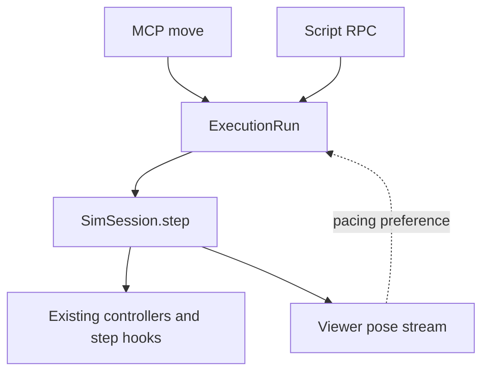

# Shared execution kernel

The first migration covers the MCP `move` command and `ScriptRunner`, including scripts launched by plugin behaviors.
Their public tool names, parameters and existing result fields are unchanged.
This is an internal execution contract; it does not declare the MCP interface or world format stable.
Robot control, motion planning and task success checks remain in their existing modules.

## One session, one owned clock

`SimSession.execution` owns admission and creates an `ExecutionRun` before a migrated command changes controllers or awaits work.
The lease covers all phases of that command, including settling and script process cleanup.
`SimSession.step(owner=run)` verifies the owner under the session lock; ordinary stepping remains available when there is no owned execution.
The viewer keeps streaming while a run owns the clock, but does not advance it a second time.

Owned runs use the same physics batches with and without a viewer.
A connected, playing viewer only adds real-time pacing, respecting the existing simulation speed setting.
Closing the viewer lets the same run continue headlessly.
As before for scripts, a paused viewer does not suspend an explicitly requested run; it runs headlessly instead.
`shown_live` records whether the run was actually paced live, including a viewer that disconnected before completion.

`move(seconds=None)` still installs a continuous command and returns immediately.
Its brief lease ends with that response; the existing viewer clock subsequently drives the controller.
A successful script may likewise leave a controller or non-waited replay running, preserving existing script behavior.

## Budgets and invalidation

`RunLimits` has independent simulation-time, wall-time and optional physics-step limits.
They accumulate over the whole run; another step request or a settling phase does not restart them.
The optional step limit is currently an internal API, not a new MCP argument.
Simulation and step budgets admit only whole physics steps that fit the remaining budget.
Phase durations are rounded to the nearest physics step, as existing simulation requests are.
Wall deadlines are checked before and after controller updates, between individual owned physics steps, and while waiting for a child process.
A single blocking native/controller call remains cooperative and cannot be preempted in the middle.

Each run captures the session's model, data and generation.
Both reset and model replacement increment the generation; reset need not change the viewer's scene version.
An invalidated run checks this before invoking completion predicates or accepting another script operation.
Nonfinite physics and clock rewind also terminate execution.
Measured progress comes from the steps the run actually performed, so resetting the world's clock cannot produce negative elapsed time.

`RunResult` distinguishes normal completion, phase duration, simulation/step/wall limits, cancellation, invalidation and unstable physics.
The adapters retain their established user-facing results.
For example, interrupted navigation returns its saved `arrived=false` / `why=interrupted` report; it does not inspect or stop a controller in the replacement world.
The kernel retains only the latest run summary rather than an unbounded history.

## Cancellation and coexistence

Cancelled moves stop only their own still-attached controller.
An external `stop` validates its target first and interrupts an active run only when that run controls the corresponding robot.
Cancelled or failed scripts terminate their process group or Windows Job Object, close RPC clients and bound output drainage before releasing the lease.
They stop controllers explicitly commanded by that script and cancel its unfinished replays.
An arm-only script does not claim a pre-existing moving base.
Failed argument validation does not claim an existing controller.
Cleanup does not stop a replacement controller or one loaded after reset.

Planning threads are cooperative.
A queued script planner checks ownership and generation under the same session lock as its work.
The script child is reaped first; the lease remains held until any already-running planner finishes and its controllers can be cleaned up safely.
This may delay the final response past a deadline when a native/plugin call blocks.
It prevents the old worker from silently attaching controls after the next run starts.

The generic `run_until` adapters have not all migrated to this driver.
Legacy controller commands use admission tokens while retaining their existing viewer-driven clocks.
New owned runs refuse to start while admitted work is outstanding, including work whose requesting client has cancelled.
The covered paths include simulate, direct controls, pose, arm/gripper work, pick/place, operate, run_controller, demonstration replay, mapping exploration and plugin controllers.
Plugin behaviors use `ScriptRunner` directly so they do not acquire a conflicting legacy token.
Viewer teleoperation and manual stepping refuse competing changes; queued viewer navigation acquires admission inside its actual worker.
Reset and world editing remain explicit invalidation paths.

## Verification and next migration

Tests in `test_execution.py` cover ownership, pacing-independent physics, cumulative budgets, cancellation, reset/model invalidation, clock rewind and slow controller deadlines.
`test_execution_tools.py` exercises move/script conflicts, controller ownership, continuous movement, replay admission and real child cancellation.
The prior real descendant/process-cleanup regressions remain in `test_runtime_boundaries.py`.
Existing navigation, recording, plugins and perception tests cover compatibility with the unmigrated adapters.

The first implementation was also driven through the installed CLI and official MCP client, with actual Chrome, live physics, recording, viewer disconnection and a real script invalidated by reset.
Measured results are in [2026-10-21-execution-kernel.md](bench/2026-10-21-execution-kernel.md).
The next migrations can reuse this driver without changing robot controllers, adding another behavior-tree system or introducing a new physics backend.
