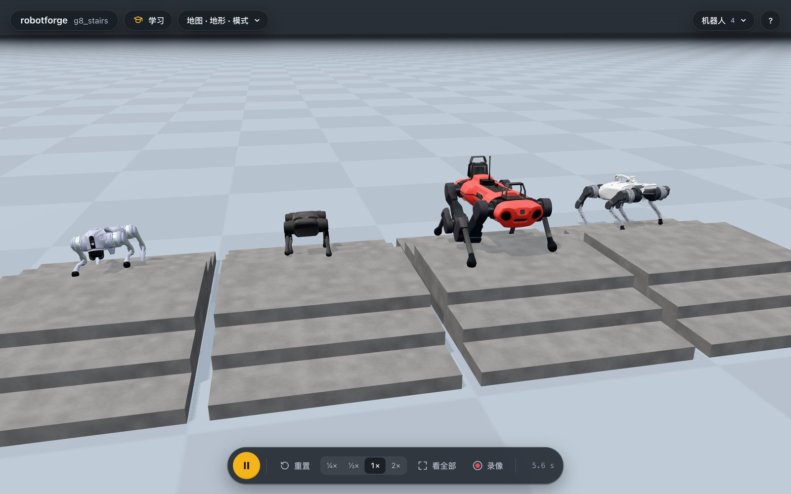
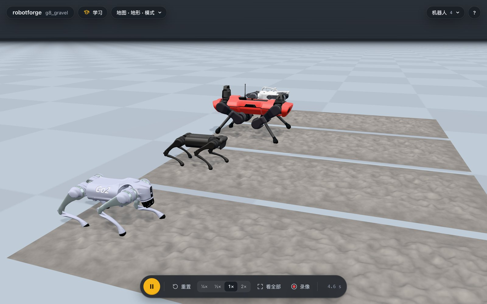

# 足式机器人：看着地面走

库里的每台腿足机器人都用 `move` 和键盘（W A S D）走，走法自动选，不用指定。
四足（Go2、Go1、A1、ANYmal C、Spot、Barkour）用内置的小跑步态（`behaviors/quadruped.py`）。
G1 用学出来的策略（UniLab 训练的 ONNX）。
T1 和 OP3 用预观控制加平衡反馈的双足步态（`behaviors/humanoid.py`）。

## 四足怎么看地面

四足走路时一边走一边看脚下和前方的地面（`behaviors/ground_scan.py`）：从躯干高度往下打射线，穿过自己的身体，只看固定在世界里的东西（地形、台阶、石头、固定的家具）；别的机器人、机械臂、能被推开的箱子不算地面，脚会自己感觉到它们。
场景里只有平地和这些会动的东西时不看，所以平地上不多花算力（有第二只狗或一台臂时也一样）。
`behaviors/footing.py` 用看到的高度给每只脚改落点：
- 每只脚落在它脚下真实的高度上，上台阶时先抬脚再往前迈，下台阶时脚不会蹭到台阶边。
- 快落在台阶边上的脚会挪到前后平整的地方。
- 落地后按脚真正踩到的面重新量高度，脚滑下台阶边也会知道。
- 躯干跟着坡度抬头或低头一半，横向保持水平；在碎石和台阶上身体晃动不再被当成被推。
- 走直线时保持原来的朝向，被台阶绊一下也不会越走越偏。
- 前方 3 条腿长内的地面起伏超过一个边（Go2 约 1.4 cm）就算难走地面，速度自动降到全速的 60% 以下：全速冲台阶时 Go2 0/3 摔倒，80% 时一半的狗摔倒，降速后 100% 命令也过。
- 库里写了 `max_slope` 的机器人（Spot，0.24）在前方 2 条腿长的地面坡度（台阶按升高比深度算）超过它时站住不往前走，`pose` 里多一项 `blocked`；还能转向、能后退。

## 实测

`uv run python scripts/legged_bench.py --trials 3` 给每台机器人每种情况跑三次（起点前后左右和朝向各不相同），用库里的真实 Menagerie 模型。
每格是：成功次数，沿出发方向的平均速度，摔倒次数，走完后朝向偏出发方向多少度。
转向一行是每秒转多少度。

| robot | flat | slope | stairs | gravel | grass | turn | shove | drag | payload |
|---|---|---|---|---|---|---|---|---|---|
| go2 | 3/3, 0.35 m/s, 0 falls, 2 deg | 3/3, 0.35 m/s, 0 falls, 2 deg | 3/3, 0.35 m/s, 0 falls, 1 deg | 3/3, 0.35 m/s, 0 falls, 1 deg | 3/3, 0.35 m/s, 0 falls, 1 deg | 3/3, 54 deg/s | 3/3, 0.35 m/s, 0 falls, 5 deg | 3/3, 0.34 m/s, 0 falls, 12 deg | 3/3, 0.34 m/s, 0 falls, 4 deg |
| go1 | 3/3, 0.35 m/s, 0 falls, 0 deg | 3/3, 0.35 m/s, 0 falls, 1 deg | 3/3, 0.35 m/s, 0 falls, 4 deg | 3/3, 0.36 m/s, 0 falls, 3 deg | 3/3, 0.36 m/s, 0 falls, 2 deg | 3/3, 56 deg/s | 3/3, 0.35 m/s, 0 falls, 0 deg | 3/3, 0.35 m/s, 0 falls, 4 deg | 3/3, 0.35 m/s, 0 falls, 3 deg |
| a1 | 3/3, 0.36 m/s, 0 falls, 1 deg | 3/3, 0.36 m/s, 0 falls, 1 deg | 3/3, 0.35 m/s, 0 falls, 5 deg | 3/3, 0.36 m/s, 0 falls, 2 deg | 3/3, 0.36 m/s, 0 falls, 1 deg | 3/3, 57 deg/s | 3/3, 0.28 m/s, 0 falls, 21 deg | 3/3, 0.35 m/s, 0 falls, 12 deg | 3/3, 0.35 m/s, 0 falls, 1 deg |
| anymal_c | 3/3, 0.37 m/s, 0 falls, 2 deg | 3/3, 0.37 m/s, 0 falls, 2 deg | 3/3, 0.36 m/s, 0 falls, 2 deg | 3/3, 0.37 m/s, 0 falls, 2 deg | 3/3, 0.37 m/s, 0 falls, 1 deg | 3/3, 54 deg/s | 3/3, 0.38 m/s, 0 falls, 1 deg | 3/3, 0.37 m/s, 0 falls, 4 deg | 3/3, 0.37 m/s, 0 falls, 5 deg |
| spot | 3/3, 0.20 m/s, 0 falls, 1 deg | 3/3, 0.17 m/s, 0 falls, 1 deg | 0/3, 0.00 m/s, 0 falls, 1 deg | 3/3, 0.20 m/s, 0 falls, 8 deg | 3/3, 0.20 m/s, 0 falls, 1 deg | 3/3, 55 deg/s | 3/3, 0.18 m/s, 0 falls, 6 deg | 3/3, 0.19 m/s, 0 falls, 2 deg | 3/3, 0.19 m/s, 0 falls, 1 deg |
| barkour | 3/3, 0.36 m/s, 0 falls, 2 deg | 3/3, 0.35 m/s, 0 falls, 1 deg | 3/3, 0.35 m/s, 0 falls, 3 deg | 3/3, 0.36 m/s, 0 falls, 2 deg | 3/3, 0.36 m/s, 0 falls, 3 deg | 3/3, 55 deg/s | 3/3, 0.36 m/s, 0 falls, 1 deg | 3/3, 0.35 m/s, 0 falls, 2 deg | 3/3, 0.35 m/s, 0 falls, 2 deg |
| g1 | 3/3, 0.59 m/s, 0 falls, 6 deg | 0/3, -0.18 m/s, 3 falls, 5 deg | 0/3, 0.59 m/s, 3 falls, 12 deg | 0/3, 0.25 m/s, 3 falls, 20 deg | 0/3, 0.24 m/s, 3 falls, 40 deg | 3/3, 26 deg/s | 3/3, 0.61 m/s, 0 falls, 5 deg | 3/3, 0.56 m/s, 0 falls, 14 deg | 3/3, 0.54 m/s, 0 falls, 16 deg |
| t1 | 3/3, 0.09 m/s, 0 falls, 3 deg | 0/3, 0.02 m/s, 3 falls, 4 deg | 0/3, 0.01 m/s, 0 falls, 3 deg | 0/3, 0.04 m/s, 3 falls, 26 deg | 0/3, 0.06 m/s, 3 falls, 37 deg | 3/3, 19 deg/s | 0/3, 0.04 m/s, 3 falls, 7 deg | 0/3, 0.05 m/s, 3 falls, 18 deg | 3/3, 0.08 m/s, 0 falls, 2 deg |
| op3 | 3/3, 0.09 m/s, 0 falls, 2 deg | 0/3, 0.06 m/s, 3 falls, 27 deg | 0/3, 0.01 m/s, 0 falls, 5 deg | 0/3, 0.06 m/s, 3 falls, 14 deg | 3/3, 0.09 m/s, 0 falls, 6 deg | 3/3, 17 deg/s | 0/3, 0.05 m/s, 3 falls, 11 deg | 0/3, 0.06 m/s, 3 falls, 111 deg | - |

- 坡：12 度上坡、平台、下坡。台阶：三级 8 cm 上去再三级下来，每级深 30 cm。碎石：3.5 cm 高、6 cm 宽。草地：2 cm 起伏的软地。
- 推：走路时侧向加 0.5 m/s。拖：查看器的拖拽弹簧 2 秒把躯干侧拉 0.4 m。负重：背上装库里它全速能背的最重机械臂（Go2 背 Z1，ANYmal 背 xArm 7）。
- 速度是全速的 60%。Spot 和人形的全速本来就低，所以它们的数字小。
- 共 240 次跑成功 192 次（九台机器人 x 九种情况 x 三次，OP3 没有库里的臂，负重 3 次不算）。`-` 是没跑。

### 台阶有多稳

上表只测一种台阶（三级，每级 8 cm 高、30 cm 深）。
下面是别的尺寸和别的速度，每格三次，成功次数（`legged_bench.py --cases stairs@高x深x级数`，高和深的单位是 cm；`--speed` 是全速的份额）：

| robot | 8x30x3 | 8x22x3 | 8x30x6 | 10x30x3 | 8x30x3 全速命令 |
|---|---|---|---|---|---|
| go2 | 3/3 | 1/3 | 3/3 | 1/3 | 3/3 |
| go1 | 3/3 | 2/3 | 2/3 | 1/3 | 3/3 |
| a1 | 3/3 | 3/3 | 3/3 | 3/3 | 3/3 |
| anymal_c | 3/3 | 3/3 | 3/3 | 2/3 | 3/3 |
| barkour | 3/3 | 3/3 | 2/3 | 2/3 | 3/3 |

所以“能上台阶”的准确说法是：Go2、A1、ANYmal C、Barkour 能上 8 cm 高、30 cm 深的台阶；10 cm 高、深度只有 22 cm 或很长的台阶，各有一两台会摔或绕开；Go1 在这些上更不稳。
没有降速时（命令全速），同一组台阶 Go2 0/3、A1 2/3、Barkour 2/3、Go1 2/3，所以现在难走地面上自动降速。

Spot 在三级台阶上的结果（每格三次）：5x30 3/3，8x40 3/3，6.5x30 2/3（不稳，摔过），8x30 站住不上（0/3，不摔）。

## 还不行的

- Spot 过不了 8 cm 高、30 cm 深的台阶，6.5 cm 高、30 cm 深的也不稳（2/3）。
  它能上 5 cm 高、30 cm 深和 8 cm 高、40 cm 深的台阶。
  Spot 身长 0.85 m，前脚已经踩上第三级时后脚还在地上，躯干被拉长，后腿推不动，最后向后摔下台阶；调抬脚高度、落脚搜索范围、步频和躯干跟坡的比例都没有解决。
  现在的处理是让它安全失败：前方坡度超过 0.24（8x30 是 0.27，8x40 是 0.20，12 度的坡是 0.21）时站住，`pose` 里有 `blocked`，不再摔倒。
  这是“不摔”，不是“能上”；要真上，得换步态（比如接触序列规划）。
- Go1 在台阶上比别的四足不稳：8x30x3 现在 3/3，但 8x22x3、8x30x6 和 10x30x3 各有一两次摔倒或走不完。
- G1 的策略只在平地上训练过：能走 4 度以内的坡和 1 cm 的碎石，12 度的坡、台阶、3.5 cm 碎石和草地都会摔。
  推和拖它能扛住。
  要它走地形，得用 UniLab 在粗糙地形上重新训练一个策略；本机上 G1 平地策略训练了约一小时，粗糙地形的训练任务在本机装的两份 UniLab 里没有现成的配置，这一步没做。
- T1 和 OP3 的平衡步态只管平地：走得慢（0.09 m/s），3 度的坡就会摔，被推或被拖会摔。
  它们的走法没有看地面的部分。
- H1 没有进库。Menagerie 的 H1 是力矩电机，踝关节最大 40 N*m，47 kg 的身体靠现有的平衡步态站不住（试过伺服刚度 150 到 600，1 到 2 秒内向后倒）。
  给它加一个能走的策略需要像 G1 那样训练一个，所以先不放进库里，免得库里有一个只会站着的人形。

## Menagerie 里别的腿足机器人

本库固定的 Menagerie 版本（`feadf76`）里还有这些腿足模型，库里一个都没加：

| 模型 | 为什么没加 |
|---|---|
| anybotics_anymal_b、google_barkour_v0 | 四足，现有步态大概能走，但和 ANYmal C、Barkour vb 是同一类，加进来不增加能力，每个要多下 40 MB 左右的网格；没试过 |
| unitree_h1 | 试过，见上面，站不住 |
| agility_cassie | 双足，不是现有的任何一类步态的形状，大概要一个训练好的策略；没试过 |
| apptronik_apollo、pal_talos、berkeley_humanoid、fourier_n1、pndbotics_adam_lite、toddlerbot_2xc、toddlerbot_2xm | 人形；平衡步态只在 T1 和 OP3 的尺寸上调过，大一些的要像 G1 那样先训练策略；没试过 |

这些里 ANYmal B 和 Barkour v0 是最便宜的下一步，人形要等有地形策略的方案。

## 视频和图

- `legged_quadrupeds.mp4`：六台四足同一条命令（0.3 m/s）并排走。
- `legged_stairs.mp4`、`legged_gravel.mp4`：四台四足各走自己的台阶和碎石。
- `legged_humanoids.mp4`：G1、T1、OP3 走路。

