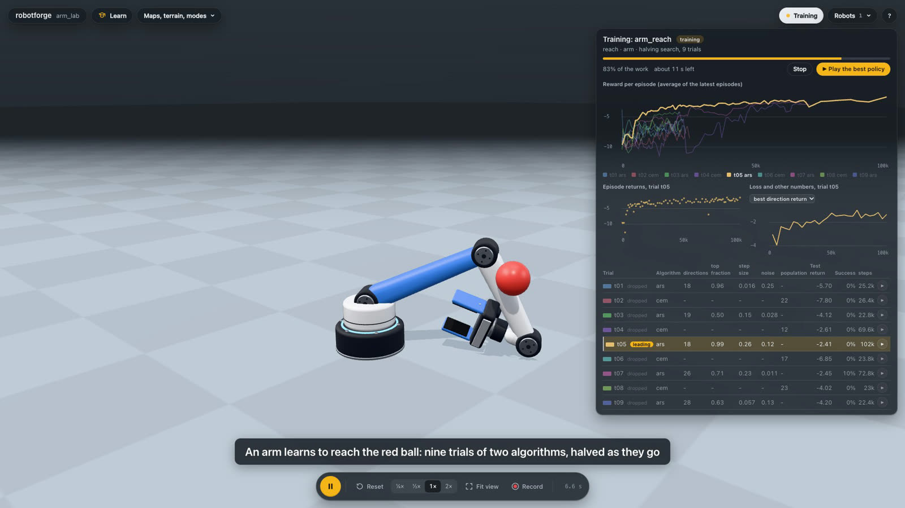

# Training any robot on any task with any algorithm

robotforge trains a policy for any robot in a world, on a task it was given, with an algorithm you pick or write, and shows the training as it happens.
The same environment, the same algorithm interface and the same view serve a quadruped built from parts, an arm with a lidar, a Go2, or a robot you imported.

- [One call](#one-call)
- [The environment: observations from the robot's sensors](#the-environment)
- [Algorithms](#algorithms)
- [Tasks](#tasks)
- [Searching for settings](#searching-for-settings)
- [The training view](#the-training-view)
- [Writing your own algorithm](#writing-your-own-algorithm)
- [What was measured](#what-was-measured)
- [Limits](#limits)

## One call

From Claude or GPT:

- "Train the dog to walk at 0.4 m/s with ARS and CEM and tell me which is better" is `train_policy(task="walk", robot="dog", algo=["ars", "cem"], task_params={"speed": 0.4})`.
- "Tune ARS for the arm" is `train_policy(task="reach", robot="arm", algo="ars", search={"trials": 9})`.
- `training_status(name)` says how each trial is going, side by side; the viewer's Training panel draws it.
- `run_controller(robot, task, method="policy:<name>")` and `compare_controllers(...)` use the result like any other algorithm.

In Python:

```python
from robotforge.training.api import train

policy = train(
    "walk",
    world=world,
    robot="dog",
    algo=["ars", "cem"],
    steps=250_000,
    task_params={"speed": 0.4},
    action_mode="residual",
    episode_seconds=4.0,
)
print(policy.meta["final"])  # the best trial: algorithm, settings, test return, the task's own numbers
```

`start(...)` has the same arguments and returns at once.
Training runs in a process of its own, trials side by side (up to four), and keeps `status.json` in the policy's folder.
Closing the agent does not stop it; `stop_training(name)` does, and keeps the best policy so far.

## The environment

`make_env(task, robot=..., world=...)` builds one environment for any robot and task (`robotforge.training`):

```python
from robotforge.training import describe, make_env

env = make_env("walk", world=world, robot="dog", task_params={"speed": 0.4})
print(describe(env))  # both spaces in words
obs, info = env.reset(seed=0)
obs, reward, terminated, truncated, info = env.step(env.action_space.sample())
```

It is the Gym-style `RobotEnv` of [ALGORITHMS.md](ALGORITHMS.md): actions in [-1, 1], one per actuator the task controls, scaled onto each actuator's range, rewards that are the task's score per second.
What is new is where the observation comes from.

### The observation follows the robot's sensors

A learner should see what the robot could sense.
Put an IMU, a lidar or a depth camera on the robot (`add_sensor`) and its numbers join the observation; take it off and they leave.
`env.layout` and `describe(env)` list which numbers sit where, by name:

| source | the numbers |
|---|---|
| the task | what the task itself reads: joint angles and speeds, the base's tilt and speed, the goal (a reach target, a commanded speed) |
| `lidar`, `lidar3d` | the nearest hit in each of `lidar_bins` slices around the robot (default 16), as a share of the range, 1 meaning nothing seen |
| depth `camera` | the picture shrunk to `depth_size` (default 8 by 6), each cell the nearest thing in its patch, as a share of the range |
| every other sensor, a plugin's included | the numbers of its own reading, the ones `read_sensors` shows: `accel_m_s2`, `rad` by joint, `total_n` ... |

Noise, latency and rate of each sensor are the ones it has in the world, because the same sensor objects measure here.
A color camera is a picture, not a few numbers, and is left out (`describe` lists what was left out and why).

`observation=` chooses how the task's own numbers and the sensors combine:

- `"auto"` (the default): the task's numbers plus the sensors, when the robot has any.
- `"task"`: the task's numbers only, as before.
- `"task+sensors"`: both; it is an error when the robot has no sensor that can be used.
- `"sensors"`: the task's goal plus the sensors only, so the policy learns from what the robot can sense.

A policy remembers how it was trained (`policy.json` keeps the environment), and runs on the same sensors anywhere: the viewer, `run_controller`, a script.
Running it on a robot that lacks one of its sensors is refused with the sensors it needs.

### Any robot, any world

- `robot` is a robot of the world (however it was made: template, library, built from parts, generated from a sentence, imported), or with no world a template or library name, or a dict like a world.yaml robot entry.
- `world` is a `World`, its dict, or a saved world's name or path.
  `scope="robot"` (the default) trains the robot, what it carries, and the world's floor and terrain; `scope="world"` trains in everything, which tasks saved with a world (`add_task`) need and get automatically.
- `episode_seconds`, `control_hz`, `action_mode` (`direct`, or `residual` on top of the built-in controller) and `push` (random shoves while training, in multiples of the usual push) shape the environment.

## Algorithms

`list_algorithms` (and `python -m robotforge.training algorithms`) lists every algorithm with its settings.

| algorithm | what it is | needs |
|---|---|---|
| `ars` | Augmented Random Search: a linear policy nudged along the random directions that earned the most | nothing |
| `cem` | the cross-entropy method: sample policies from a Gaussian, refit it to the best; `hidden` adds a hidden layer | nothing |
| `ppo` | Stable-Baselines3 PPO: a neural network improved in small safe steps | the `rl` extra |
| `sac` | Stable-Baselines3 SAC: an actor and a critic learning from a replay memory | the `rl` extra |
| yours | any function `run(ctx)`, see [below](#writing-your-own-algorithm) | |

All of them leave the same kind of policy, plain numpy arrays (`policy.npz`), which run without PyTorch.
Each setting has a default that needs no tuning and a range a search draws from; `settings={"ars": {"noise": 0.1}}` fixes some.
Several names in `algo` run side by side on the same task and the same test episodes, which is how to compare them.

## Tasks

`task` is any of:

- the built-in ones: `reach`, `balance`, `stand`, `walk`, `drive_to`, `hover` ([ALGORITHMS.md](ALGORITHMS.md));
- a task saved with the world by `add_task`, by its name;
- one a plugin added, such as a task written as a reward function (`robotforge.training.custom.reward_task`, [EXTENDING.md](EXTENDING.md#algorithms-and-tasks-training-with-your-own)).

`reach` takes a `jitter` (meters): with a target, every episode moves it by up to that much, so the policy learns a small region rather than one point.
A ball named `target` in the world is where a reach policy aims when the viewer plays it.

## Searching for settings

`search={...}` runs several trials and keeps the best.

- `"method": "random"` runs every trial for the full budget.
- `"method": "halving"` (the default) is successive halving: all trials start on a small budget, the best third go on with three times more, and so on, so most of the work goes to the promising settings.
  A trial that goes on is continued from where it stopped, not restarted.
- `"trials"` (at most 64), `"eta"` (how many are dropped at a rung, default 3), `"seed"`.
- `"space"` says where to look: a list picks among values, `{"low": 0.01, "high": 0.3, "log": true}` draws between, a bare number fixes one.
  Settings left out are drawn from their own ranges; `"all_settings": false` searches only the ones named.
- With several algorithms the trials take them in turn, so the search also compares the algorithms.

Trials are ranked on test episodes that every trial shares (the same start seeds, calm), never on their noisy training episodes.
`timesteps` is the environment steps each trial may use at most; a halving search spends a fraction of that on most of them.

## The training view



The viewer shows a Training button once a run exists (top right) and opens the panel by itself when a run starts.

- One chart with the learning curve of every trial: the leader bold, the dropped trials faded.
- The leader's episode returns, one dot per episode, and a loss or other series the algorithm reports (the selector lists them), for the trial you click in the table.
- A table with the settings of the trials side by side (the ones that differ, or all of them for a single trial), their test return and success rate, steps and state, and a play button on each row.
- Progress, time left, a Stop button, and "Play the best policy": the policy runs on its robot in the world.
  Open the world the robot was trained in first; a reset starts it again.

Agents get the same facts in `training_status`: each trial's settings, state, steps, latest losses, a handful of curve points and its test return, and which trial leads.

## Writing your own algorithm

An algorithm is a function `run(ctx)`; the complete contract and an example are in [EXTENDING.md](EXTENDING.md#algorithms-and-tasks-training-with-your-own).
It registers with `@algorithm(name, hyper={...})` in a plugin file, appears in `list_algorithms`, trains with `train_policy(algo=name)`, takes part in searches over its `Hyper` ranges, shows its `ctx.log(...)` series on the panel, and leaves a policy like the built-in ones.
`ctx.state` keeps arrays between a search's stretches, so a promising trial continues rather than restarts.

## What was measured

Real simulations on a MacBook with a loaded machine (other work was running), `scripts/training_media.py` reproduces them.

### A quadruped built from parts learns to walk faster

The robot is `add_robot("dog", describe="a robot dog")`: 15 generated parts, 13 actuators, with its own IMU and touch pads, and `add_sensor("dog", {"type": "encoders"})` on top.
Its observation is 68 numbers: the task's 38, the IMU's 9 (two of them), the touch pads' 8 and the encoders' 13.
The task is `walk` at 0.4 m/s, as corrections on the built-in gait, 4 s episodes with shoves, 700k steps per trial, two trials side by side (7 min 8 s in all on a loaded machine).
Scores are 10 test episodes on the same starts, no shoves.

| | test return | speed | success | settings |
|---|---|---|---|---|
| built-in gait alone (the do-nothing correction) | 5.404 | 0.20 m/s | 90% | |
| ARS | 7.311 | 0.29 m/s | 100% | defaults: directions 8, step_size 0.1, noise 0.3 |
| CEM | 7.178 | 0.35 m/s | 100% | defaults: population 24, init_std 0.5 |

Both beat the gait it started from by 45 to 75 percent in speed and stay upright.
CEM walks faster, ARS earns the slightly higher return; the panel shows the two side by side.

### An arm learns to reach, and a search makes the difference

The robot is the arm template with encoders; the task is `reach` a red ball, 22, 8 and 14 cm from the base, which moves up to 4 cm every episode (`jitter`); success is the tool within 3 cm; 2 s episodes, direct actions, 200k steps per trial.

| | test return | tool to ball | within 3 cm |
|---|---|---|---|
| doing nothing | -8.655 | 48 cm | 0% |
| ARS, default settings | -3.086 | 15.8 cm | 0% |
| CEM, default settings | -2.366 | 10.5 cm | 5% |
| best of a search (trial t05, ARS: step size 0.26, noise 0.12) | -1.087 | 2.3 cm | 80% |

The default settings, taken as they are, get close and no further.
The search is successive halving over nine trials of ARS and CEM, `eta` 3, drawing the noise, the step size and CEM's starting spread from log ranges:

| trial | algorithm | step size | noise or spread | steps run | test return | tool to ball | fate |
|---|---|---|---|---|---|---|---|
| t01 | ars | 0.016 | 0.252 | 25k | -5.703 | 32.0 cm | dropped |
| t02 | cem | - | 0.075 | 26k | -7.8 | 43.5 cm | dropped |
| t03 | ars | 0.146 | 0.028 | 22k | -4.124 | 18.7 cm | dropped |
| t04 | cem | - | 0.038 | 69k | -2.606 | 13.4 cm | dropped |
| t05 | ars | 0.263 | 0.118 | 208k | -1.087 | 2.3 cm | went on to the full budget |
| t06 | cem | - | 0.454 | 23k | -6.849 | 31.1 cm | dropped |
| t07 | ars | 0.226 | 0.011 | 72k | -2.446 | 5.1 cm | dropped |
| t08 | cem | - | 0.158 | 23k | -4.02 | 11.8 cm | dropped |
| t09 | ars | 0.057 | 0.130 | 22k | -4.2 | 21.1 cm | dropped |

The whole search, trials side by side three at a time, took 33 s with three side by side.
The poorest trials are dropped after about 25k steps; the leader's number of directions, large step and moderate noise are not what the defaults chose, which is what a search is for.

### PPO and SAC through the same call

On the same arm task, 30k steps each (far too few to converge, only to show the adapters run): PPO 16.3 cm, SAC 14.6 cm from the ball; both report their losses to the panel (`value_loss`, `policy_gradient_loss`, `entropy_loss` for PPO; `actor_loss`, `critic_loss`, `ent_coef` for SAC) and a halving search continues a PPO trial from its saved model.

### Speed

The dog's environment, with its sensors read at every step, runs about 1,700 steps a second in one process; the two 700k-step trials above took 7 minutes together on a machine that was busy with other work.

## Limits

- Trials are trained on the robot's world as `scope` says; a task that depends on other robots moving is trained with them standing still.
- PPO and SAC train one simulation per trial (a search runs trials side by side instead), so a single PPO run is slower than control/rl's eight-process trainer, which `train_policy` still uses for plain `algo="ppo"` or `"sac"` on a robot without sensors and without a search.
- Cameras other than depth are not part of an observation.
- `halving` needs `timesteps` per trial; with only `minutes` a search is refused.
- A plugin algorithm or task is code: it runs in the training process with your rights, like any plugin ([EXTENDING.md](EXTENDING.md#where-plugins-live)).
